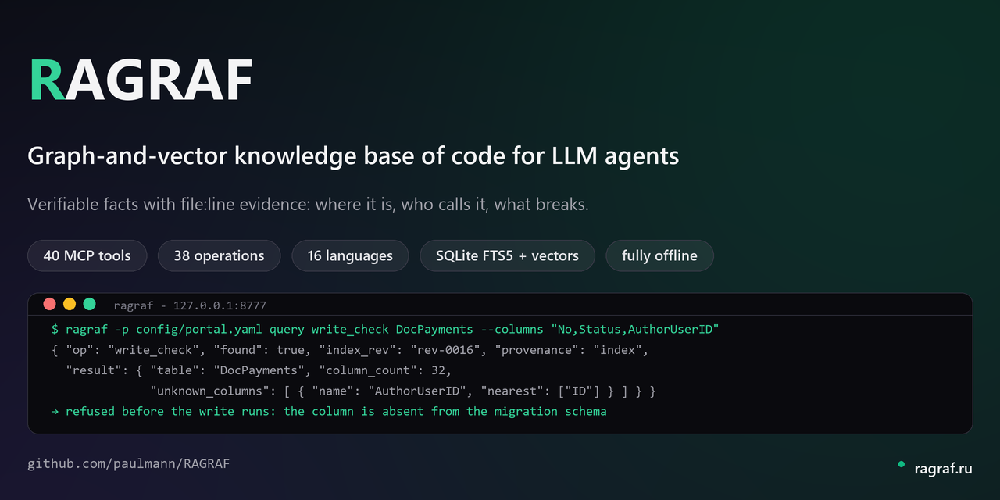

# RAGRAF

<!-- md-i18n:switcher -->
**其他语言：** [Русский](README.ru.md) · [Deutsch](README.de.md) · [English](README.md) · [Español](README.es.md) · [हिन्दी](README.hi.md) · 中文

> **0.4.0 完整译本。** 本文件是主文档 [`README.md`](README.md) 的中文译本：改动只发生在主文档，两者不一致时以英文文本为准。本译本状态：27.10.2026。

**面向 LLM 智能体的图-向量代码知识库。**

[](https://github.com/paulmann/RAGRAF/actions/workflows/ci.yml)
[](https://github.com/paulmann/RAGRAF/releases)
[](LICENSE)
[](pyproject.toml)



[**快速开始**](#第一步) · [**文档**](#文档) · [**Wiki**](https://github.com/paulmann/RAGRAF/wiki) · [**更新日志**](CHANGELOG.md) · [**English version**](README.md)

> **文档状态。** 下文每个数字都在 2026 年 10 月 26–27 日针对 0.4.0 版实测；RAGRAF 索引的规模由 `Test-DocumentedNumbers` 与活动修订记录比对，属于过去修订的数字会让发布闸门失败，而不会被当成今天的实测值放过。

一个回答智能体关于代码库问题的助手——*代码在哪里、谁在调用它、改动会破坏什么、附近类似功能是怎么做的*——给出可验证的事实（`file:line`），而不是盲目的 `rg` 和整文件通读。Python 3.13+、SQLite（图 + FTS5 + 向量在同一个地方）、tree-sitter、无需 torch 的本地嵌入。可选的代码属性图层（Java + Joern）解锁切片；没有它，产品照常工作，并如实说明这一点。

---

## 目录

- [这是什么，以及为什么需要它](#这是什么以及为什么需要它)
- [能力](#能力)
- [实现原理](#实现原理)
- [安装](#安装)
- [第一步](#第一步)
- [环境要求与限制](#环境要求与限制)
- [文档](#文档)
- [开发](#开发)
- [参与](#参与)
- [用数字看项目与实测基准](#用数字看项目与实测基准)
- [许可证](#许可证)

---

## 这是什么，以及为什么需要它

在代码上做改动的智能体，把大部分上下文花在**定位**上：函数在哪里定义、谁在调用它、附近类似的功能是怎么实现的。惯常做法是 `rg` 加整文件通读。

RAGRAF 用索引取代这条路径。智能体通过固定操作提问，得到带 `file:line` 引用的事实，而不是十个待查看的候选。

在真实项目上实测（PHP 门户，14 个导航任务，`bench/results/`）：

| 指标 | 无索引 | 有索引 |
|---|---|---|
| 14 个任务的工具调用次数 | 28（现实值 43） | **14** |
| 每任务平均 | 2.0 / 3.1 | **1.0** |
| 待查看的候选 | 最多 34 个文件 | 1–5 个精确的 |
| 整文件读取 | 14（最少值） | **0** |
| 首次查询即命中目标文件 | — | **92%**（13 次中 12 次） |
| 可验证性（带 `file:line` 引用的事实） | — | **100%** |

调用次数、命中率和可验证性是**实测值**（运行制品在 `bench/results/`）。「现实值 43」是一次模型修正——智能体最多查看五个候选而不是一个——它记录在制品本身里。

一个通常被省略的限定：**2–3 倍的收益只属于定位类任务**（「在哪里定义」「谁调用它」）。在「读 → 改 → 验」的改动循环里，调用次数几乎没有变化；那里的收益在别处：改动不会破坏索引，有疑问的 SQL 在运行前就被校验。

---

## 能力

**54 个操作**作用于代码仓库——固定集合，没有面向图的查询语言：

| 操作 | 回答什么问题 |
|---|---|
| `search` | 关于这件事写在哪里（混合检索：BM25 词法 + 向量） |
| `search_multi` | 哪几处同时出现多个字符串；哪些文件互为副本、哪一份是活跃的 |
| `duplicates` | 哪些文件互为副本，以及靠什么证明哪一份是活跃的 |
| `entrypoints` | 入口点：路由、HTTP 处理器、CLI、标记中的端点 |
| `dead_code` | 没有引用、不在可达范围内的文件与子程序 |
| `symbol` | 符号定义在哪里：种类、文件、行号、签名 |
| `references` | 还在哪里被使用 |
| `callers` / `callees` | 谁调用它 / 它调用了谁 |
| `impact` | 改动会影响什么（已证明的边与启发式的边分开） |
| `slice` | 结构化切片：节点、边、行号——不含函数体 |
| `code` | 符号的函数体（仅在明确请求时） |
| `repo_map` | 在给定字符预算内的仓库地图 |
| `schema` / `table_usage` | 数据库表里有什么，谁读它、谁写它 |
| `routes` | 路由与入口点 |
| `policy_trace` | 谁、依据什么条件获得权限 |
| `class_usage` | 样式类：定义在哪里、用在哪里、两者在哪里不一致 |
| `write_check` | 能否这样写入（运行前把写入计划与模式对照） |
| `live_read` | 当前文件，并标出与索引之间的差异 |
| `freshness` | 索引是否最新（校验和比对） |
| `index_status` | 修订、覆盖度、降级情况、日志大小 |
| `drift_report` / `drift_ack` | 索引与代码之间差异的日志 |
| `catalog` | 语料登记册：哪些已索引、各自校验和是多少 |
| `route` | 该去哪里找答案：哪个语料能回答、为什么（不引用文本） |
| `neighbors` | 同一技术栈的邻近语料里有没有现成的实现 |
| `calibrate` | 阈值校准 |
| `usage` | 访问遥测与效果评估 |
| `diff` | 两个修订之间变了什么：文件、符号、边、回归（P2-1） |
| `task_stats` | 按任务的报告：索引调用次数、闸门决策（§3.4） |
| `gate` | 对一次工具调用的闸门决策：`allow` / `ask` / `deny`（§3.2） |
| `note` / `notes` | 写入并读取一条决策笔记——跨会话的知识（P2-3） |
| `quality_suite` / `quality_diff` / `quality_prune` | 质量回路（pro 版）：运行索引检查、比较两次运行、带着副本与确认精简运行日志 |
| `shared_index_status` / `shared_index_publish` / `shared_index_query` | 团队索引（pro 版）：为网络读取发布语料、接纳客户端、查询已发布的索引 |
| `broker_issue` / `broker_rotate` | 机密代理（pro 版）：按请求签发机密——带期限、保管人和原因的租约——并按计划轮换值（轮换会撤销租约） |

另有两种模式不是操作，而是回答的形式：**`answer=true`** 返回带引用的成文回答，而不是结构化结果（P2-2）；`brief=true` 返回回答的简短外壳。`usage` 给出效果指标（`saved_calls`、`hit_rate`、`avg_ms`、`misses`、`stale_served`）。

同一批操作也以 **61 个 MCP 工具**（`ragraf_*`）提供——用于作为服务器接入智能体，同时也通过 CLI 提供。其中一组工具是数据库活层：`ragraf_db_schema`、`ragraf_db_table`、`ragraf_db_relations`、`ragraf_db_sample`、`ragraf_db_drift`、`ragraf_db_cross`。封闭层级（enterprise 版）的两个操作以工具形式声明：`ragraf_license_offline`（离线许可证：申请、签发、接受、转移）与 `ragraf_attest_bundle`（交付认证：带签名的证据包及其校验）。质量回路（pro 版）是 `ragraf_quality_suite`（索引检查套件加运行记录）、`ragraf_quality_diff`（两次运行之间的差异）与 `ragraf_quality_prune`（精简运行日志：默认只做演练，删除仅在确认并在日志副本之后）。共享索引的三个操作（同样属于 pro）不在 MCP 集合里：它们管理发布与网络通道，而不是索引读取，以 `python -m ragraf.shared_index` 运行（见 `docs/03_implementation/SHARED-INDEX.md`）。机密代理（pro）由两个工具表示——`ragraf_broker_issue`（租约：期限、保管人、原因、一次性兑换）与 `ragraf_broker_rotate`（计划状态、排期、带租约撤销的轮换）；租约状态存放在 `catalog/broker.json`，存储模式不变。
第二十四个是 `use_project`：当一个服务器服务多个项目时选择语料。`context` 回答选中了哪个语料、依据是什么——没有它，关于别的项目的回答与本项目的回答无法区分。

**二十九种语言**被解析成语法树（图的节点与边）。其中十六种由配置文件描述节点映射：PHP、Python、JavaScript、TypeScript、Java、C#、C、C++、Ruby、Lua、Go、Perl、bash、PowerShell、CSS、HTML。其余十三种（Rust、Kotlin、Swift、Scala、Dart、R、F#、OCaml、Solidity、Fortran、MATLAB、Elm、Lisp）从语法自身的标签查询获取节点名：它们的节点名与熟悉的那些不一致，而为每种语言写一份配置等于凭空发明名字。每种语言都在样例文件上校验——至少找到一个符号（`tests/test_new_languages.py`）。

另有四十种以纯文本方式接入：搜索能找到这些文件，但它们不产生节点。它们是 Julia、Elixir、Erlang、Haskell、Clojure、Groovy、Visual Basic、Pascal/Delphi、Objective-C、Zig、Nim、Crystal、Tcl、Prolog、Ada、Verilog、VHDL、汇编、HCL/Terraform、Dockerfile、Makefile、CMake、SCSS、Less、Vue、Svelte、GraphQL、Protobuf、SQL、batch、Markdown、RST、YAML、JSON、TOML、INI、XML、纯文本以及 `document` 语言。

**文档被完整索引，包括旧版本。** Word：`.docx`、`.docm`、`.dotx` 与 `.doc`（Word 97 通过专用的 OLE 解析器，不用 LibreOffice）。Excel：`.xlsx`、`.xlsm`、`.xltx` 与 `.xls`（BIFF8）。PowerPoint：`.pptx`、`.pptm`、`.ppsx`、`.potx` 与 `.ppt`。此外还有 PDF、OpenDocument（`.odt`、`.ods`、`.odp`、`.odg`）、EPUB、RTF、`.eml` 与 `.msg` 邮件，以及 WPS Office 文件。没有解析器的格式（Pages、OneNote、CHM、DjVu、`.xlsb`）不会假装是空文档——它们会带着原因被报告。

索引哪些内容在面板里选择：**设置 → 「格式」选项卡**——84 种格式按类别分组（语言、文档、数据），可按名称、扩展名和解析方式筛选，有「全部」/「无」按钮和已启用条目计数。默认启用所有格式，`*` 表示「全部，包括以后新增的」。禁用一种格式会改变语料内容，并在下一次新鲜度检查时触发重新索引。

---

## 实现原理

每个语料**三个 SQLite 存储**，位于**被索引项目内部**的 `.ragraf/` 目录：

| 存储 | 里面有什么 |
|---|---|
| `graph.sqlite` | 节点（类、函数、方法）、边（调用、继承、导入）、数据库模式 |
| `lexvec.sqlite` | 同一个文件里的 FTS5 词法（BM25）与向量；用于片段输出的原始分块文本 |
| `control.sqlite` | 修订、差异日志、访问遥测 |

**索引流程：** `scan`（遍历与校验和）→ `ast`（tree-sitter：符号、调用、SQL）→ `load` → `resolve`（名称）→ `schema`（来自迁移的表）→ `cpg`（通过 Joern 的跨过程调用）→ `lexvec`（FTS5 + 向量）。

**三个决定行为的设计取舍**——每一个都源自一个实测缺陷：

1. **不可变索引加差异日志，取代「边用边更新」。** 在一次修订内索引不变；代码改动累积到日志里，受影响的事实标记为 `stale`。否则不同时刻的事实会混在同一个回答里，而没有任何东西能把它们区分开——错误结论正是这样产生的。
2. **不给智能体面向图的查询语言。** 只有固定操作。依据：在 LLMxCPG（USENIX Security '25）中，基础模型给出 132/1278 和 19/1278 个有效的 CPGQL 查询，而经过训练的模型是 1278/1278——也就是说，自由语言会变成错误生成器。
3. **每个事实都带证据。** `path:line`、`provenance`（`stated`——已证明，`derived`——启发式）、`index_rev`、`confidence`。没有证据的边之所以看起来可靠，只是因为它是「从数据库里」来的。

**降级而不是崩溃。** 缺少代码属性图层时得到 `capability=degraded`，`slice` 给出说明实际模式的明确拒绝；其余操作照常工作。没有嵌入模型时词法检索照常工作。没有空闲端口时服务器说明原因。静默降级不存在。

---

## 安装

需要 **Python 3.13 或更新版本**。不需要管理员权限。

### Windows（PowerShell 7.6+）

```powershell
git clone https://github.com/paulmann/RAGRAF.git
cd RAGRAF
pwsh -NoLogo -NoProfile -File scripts/install.ps1
```

脚本会在 `~/.ragraf/venv` 创建虚拟环境、安装依赖，并**检查结果是否真的可用**——一步一步，最后给出汇总表。它不会假装装好了什么：每一步都以校验结束。

常用变体：

```powershell
# 安装并立即为自己的项目准备语料
pwsh -File scripts/install.ps1 -Project C:\work\myproject

# 同上，并做完整索引（会下载约 240 MB 的嵌入模型）
pwsh -File scripts/install.ps1 -Project C:\work\myproject -Index

# 不建向量的索引：不下载模型，词法搜索照常可用
pwsh -File scripts/install.ps1 -Project C:\work\myproject -Index -NoVectors

# 在带 TLS 检查的网络里（企业代理）
pwsh -File scripts/install.ps1 -WithTruststore
```

### 其他平台

一条通用路径，适用于任何有 Python 3.13+ 的地方：

```bash
git clone https://github.com/paulmann/RAGRAF.git
cd RAGRAF
python -m venv .venv
. .venv/bin/activate            # Windows: .venv\Scripts\Activate.ps1
pip install -e .                # 或：pip install -r requirements.txt
ragraf --version
```

不安装包产品也能工作——通过一个自己把 `src/` 加入路径的包装器：

```bash
python tools/ragraf.py --version
```

> `scripts/install.ps1` 已在 Windows 上验证（PowerShell 7.6、Python 3.14.7）。Linux 和 macOS 上的 `pip` 路径**未验证**——产品的开发和实测都在 Windows 上进行。

### 外部层：Java 与 Joern（可选）

跨过程图（`slice` 操作）需要 JDK 21 和 Joern。没有它们产品照样工作：索引会构建，检索和结构可用，`slice` 会带着原因拒绝。

```powershell
pwsh -File scripts/install-joern.ps1
```

归档放在 `.tools/downloads/`——脚本是幂等的。解压后的套件约占 5 GB。

---

## 第一步

```bash
# 1. 准备语料：找到它、缺失时创建、重建过时的索引。
#    陌生目录的语料也是由这条命令创建。
ragraf ensure C:\work\myproject

# 2. 检查环境（11 个组件的报告）。
#    注意：该命令始终返回代码 0 —— 它不是闸门，请读报告。
ragraf -p <config> selftest

# 3. 提问
ragraf -p <config> query search "reindex latency"
ragraf -p <config> query symbol --name corpus_hash
ragraf -p <config> query code --name corpus_hash
ragraf -p <config> query callers --name dedupe
ragraf -p <config> query impact --target Facade --depth 2

# 4. 新鲜度：索引之后代码是否改变
ragraf -p <config> check
```

完整命令列表见 `ragraf --help`。重要：**全局选项 `--project/-p` 和 `--json` 写在子命令之前**（`ragraf -p cfg query search ...`），子命令自己的选项写在它之后。

### 语料管理

```bash
ragraf init C:\work\myproject         # 创建语料配置并打印其路径
ragraf -p <config> register           # 把项目登记到注册表
ragraf -p <config> index              # 完整索引
ragraf -p <config> reindex            # 重新索引并归档差异日志
ragraf -p <config> drift --scan       # 登记差异，但不改索引
ragraf -p <config> status             # 状态：修订、覆盖度、日志大小
ragraf -p <config> usage              # 遥测：调用、事实、效果评估
```

### 作为 MCP 服务器接入智能体

```json
{
  "mcpServers": {
    "ragraf": {
      "command": "python",
      "args": [
        "/path/to/RAGRAF/tools/ragraf-mcp.py",
        "--project", "/path/to/RAGRAF/examples/mycorpus.yaml",
        "--agent", "my-agent",
        "--agent-kind", "external"
      ]
    }
  }
}
```

`--project` 是必需的。`--agent` 和 `--agent-kind` 只用于按智能体分别统计访问：没有它们，调用会以 `unknown` 记入日志。

### 设置面板

```bash
python tools/ragraf-admin.py --no-browser
```

它在 `127.0.0.1:8777` 打开，并且只监听这个地址。它显示语料及其索引状态、存储大小、索引质量和访问统计。修改类请求需要访问令牌，令牌在启动时打印。

来源页面——`http://127.0.0.1:8777/sources`：「我就是你」模式允许的根目录、它们的状态、添加、扫描、启用和删除。改动需要同一个令牌；文件内容从不读取，带机密的文件只以一个计数和一条规则的形式可见。网络根目录只接受 UNC 路径或带 `--network` 的挂载路径；URL 连接器（`ssh://`、`s3://`、`webdav://`）没有实现，会带着原因被拒绝。

价值页面——`http://127.0.0.1:8777/value`：30 天的调用、事实、令牌与行数估算，跨语料合计。估算值有标注；路径和查询不在那里。

---

## 环境要求与限制

| 项目 | 取值 |
|---|---|
| Python | **3.13+**（在 `requires-python` 中声明；在 3.14 上验证过） |
| 平台 | Windows + PowerShell 7.6——已验证；其他操作系统**未验证** |
| 权限 | 不需要：一切都从用户目录运行 |
| 磁盘 | 语料索引 `.ragraf/`——大约每 1–2 个源文件 1 MB；Java/Joern 层约 5 GB |
| 网络 | 需要两次：安装时（PyPI）和**首次带向量的索引**时——约 240 MB 的嵌入模型会下载到 `~/.ragraf/models` |
| Java + Joern | 可选；没有它们 `capability=degraded`，`slice` 不可用 |
| 显卡 | 可选；只加速向量编码，按回本阈值启用 |

**关于网络与证书。** 在带 TLS 检查的网络里（企业代理），模型下载会在证书校验处失败。安装 `truststore` 可以解决：

```bash
pip install truststore      # 或：install.ps1 -WithTruststore
```

在家庭网络里不需要这个包。实测：没有它——`certificate verify failed`；有它——240 MB 用 9.2 秒下载完。

**关于模型缓存。** 缓存目录由 `RAGRAF_MODEL_CACHE` 覆盖。读操作从不下载模型——只有带向量的索引才会。

---

## 文档

| 文档 | 里面有什么 |
|---|---|
| `docs/02_architecture/ARCHITECTURE.md` | 原则、组件、存储模式、操作契约 |
| `docs/02_architecture/TZ.md` | 功能与非功能需求、验收标准 |
| `docs/03_implementation/INTEGRATION.md` | 接入智能体：MCP、工作规则、规程 |
| `docs/03_implementation/AGENTS_SETUP_AND_CAPABILITIES.md` | 在 HARNESS 与 AutoClaw 中的安装，完整能力目录 |
| `docs/03_implementation/HARNESS_INTEGRATION.md` | DeepSeek Harness：MCP、技能、规则、闸门 |
| `docs/03_implementation/AUTOCLAW_INTEGRATION.md` | AutoClaw：MCP、技能、规则、回滚 |
| `docs/03_implementation/CPG_INTEGRATION.md` | 代码属性图：Joern、JDK、降级模式 |
| `docs/skills/ragraf-core/SKILL.md` | 使用索引的技能：选操作、恢复 |
| `docs/05_article/RAGRAF_ARTICLE.md` | 综述文章：技术栈、架构、实测 |
| `AGENTS.md` | 本项目的开发规则；基线约定检查器 |

---

## 开发

```bash
# 测试以独立脚本运行 —— 没有统一的 runner
python tests/test_lang_routing.py
python tests/test_watch.py

# 项目约定检查器（14 项检查）
pwsh -NoLogo -NoProfile -File tools/Invoke-ProjectDoctrine.ps1

# 更新 RAGRAF 自身的索引
python tools/ragraf.py ensure .
```

交付里只包含那些在**合成夹具**上运行、并且能原样带走的检查。其余的测量作者真实语料（PHP 门户、C# 服务、它们的项目配置）上的行为，在别的代码上没有意义。

安装后立刻就能通过的检查：

| 测试 | 检查项 |
|---|---|
| `test_lang_routing.py` | 56 |
| `test_watch.py` | 31 |
| `test_script_extract.py` | 25 |
| `test_threshold.py` | 23 |
| `test_ensure.py` | 17 |
| `test_csharp_records.py` | 12 |

有三项检查需要基础安装里没有的东西，这**不是交付的缺陷**，而是检查本身的性质：

* `test_joern_server.py`——需要 Java + Joern 层（`scripts/install-joern.ps1`）；
* `test_graph_algo.py`——需要 `torch`（约 2.5 GB），而它既不在 `pyproject.toml` 里，也不在 `requirements.txt` 里：显卡上的图算法是一条可选分支，没有 `torch` 时它会如实降级到处理器；
* `test_cpg_call_names.py`——需要语料配置（`config/` 目录不发布）；把 `examples/ragraf.example.yaml` 复制到 `config/` 并在其中指定自己的根目录，就能运行它。

`selftest`——**不是闸门**：它打印 11 个组件的报告，并且始终以代码 0 退出。它没有别种返回码，所以「selftest 是绿的」本身什么也证明不了。

---

## 参与

有用的报告：可复现的缺陷，带命令和输出；与代码不一致的文档；产品没有命名的降级情形。最受欢迎的只有一件事：带文件名和行号的事实。

这个项目是为具体任务而建的，所以架构建议比没有事先沟通的大补丁更容易得到讨论。

---

## 用数字看项目与实测基准

公开发表的数字（2026-10-27 核对；索引规模取自 2026-10-27 的 `rev-0411` 记录）：外观上的 **54 个操作**、**61 个 MCP 工具**、**21** 个 CLI 子命令、**29** 种语法树语言与 **40** 种文本接入语言（包括 `document`）、登记表中 **84** 种数据格式（61 种语言、9 类文档家族、10 类数据、4 种无解析器）；RAGRAF 自身索引——867 个文件、5 212 个节点、68 580 条边（快照由 `Test-DocumentedNumbers` 与活动修订记录比对：属于过去修订的数字会给出带其 `rev_id` 与日期的警告，而在发布时这就是拒绝——`tools/release/gate_release.py`；活动数字来自 `python tools/ragraf.py -p config/ragraf.yaml status`）。

**试验场，已去个人化**（去掉项目名、路径和域名）。本节的数字是 **2026-10-16 的快照**，不是当前状态：当时登记册里有 **28 个语料、25 个已索引**——10 个带 CPG 层，15 个处于 `degraded` 模式。其中 16 个的修订记录在同一天读过：**7 527 个文件、94 528 个符号、791 871 条边、86 790 个分块**。

登记册的当前规模故意与快照分开：它每接入一个项目就会变，把它放进下表会把昨天的测量冒充成今天的。它单独占一行，并与 `catalog/catalog.json` 比对——**按 2026-10-27 的登记册：42 个语料、33 个已索引**。有一项检查盯着这个数字：它一旦与登记册不符，那就是一条发现，而不是一行过时的文字。

| 语料 | 类型 | 文件 | 符号 | 边 | 模式 |
|---|---|---|---|---|---|
| C-02 | PHP Web 应用 | 2 722 | 32 761 | 355 192 | degraded |
| C-04 | C# 服务 / 桌面程序 | 1 274 | 20 331 | 98 605 | degraded |
| C-05 | PHP Web 应用 | 928 | 17 381 | 99 029 | full |
| C-18 | PowerShell 自动化集 | 81 | 324 | 4 214 | degraded |
| C-24 | Markdown + bash（最小） | 18 | 184 | 1 515 | degraded |

完整的 16 行表格、去个人化规则与计数口径的说明在[维基 → 基准与限制](https://github.com/paulmann/RAGRAF/wiki/11-Benchmarks-and-Limits)。口径说明：语料登记册与修订记录对同一次修订给出不同的总数（符号 8 721 对 4 498，边 41 201 对 56 106），所以数字取自修订记录。`C-*` 标签到项目的私有对照表留在仓库之外：它属于作者，不属于交付。

---

## 许可证

**[Business Source License 1.1](LICENSE)**——源码是公开的，许可证允许任何用途，包括组织内部的商业活动和生产使用。只有一件事被禁止：把产品或其衍生物作为托管或管理服务提供给第三方，而该服务的主要价值就是 RAGRAF 的功能。某个版本发布四年之后，它转为 Apache-2.0。

真值来源——一个文件回答一个问题，不做复述：

| 问题 | 文件 |
|---|---|
| 许可证文本及其参数 | [`LICENSE`](LICENSE) |
| 第三方及其许可证 | [`NOTICE`](NOTICE) |
| 贡献条款 | [`CLA.md`](CLA.md) |
| 支持：承诺了什么、没承诺什么 | [`SUPPORT.md`](SUPPORT.md) |
| 允许什么、不允许什么、许可证变更史 | [`docs/03_implementation/LICENSING.md`](docs/03_implementation/LICENSING.md) |

> BSL 1.1 **不是开源许可证**：OSI 不批准它，所以正确的说法是「source-available」「源码公开」。GitHub 上的许可证徽章显示「Other」：BSL 不在它所识别的目录里。

授权范围没有涵盖的情形，需要权利人单独的商业许可：所有未明确授予的权利仍归权利人。此前已授予的权利不会被撤销——许可证变更史在 [`docs/03_implementation/LICENSING.md`](docs/03_implementation/LICENSING.md)。

外部依赖保留各自的许可证：带实测版本号的清单在 [`NOTICE`](NOTICE)。Java 与 Joern 不属于交付，需要单独安装。

### 机密信息库（负责人决定 2026-10-24）

原先的规则是「值不存在，也不可能存在」——只登记位置。负责人改变了这个决定：值是需要的，但它只能存放在 `catalog/`（语料之外）、只能以密文存放，并且凭权限发放给智能体，同时留下审计记录。「不索引」的规则不变：`catalog/**` 被排除在语料之外，所以值既不会进入索引，也不会进入搜索。

- 类型：口令、令牌、API 密钥、私钥、证书、连接字符串、SSH 密钥、webhook、笔记——也就是说，不只是「口令」；
- 加密：PyNaCl `SecretBox`（XSalsa20-Poly1305），每条记录用的密钥由主密钥以记录标识为盐派生，记录上下文被嵌入密文——把行在记录之间互换会被真实性校验拒绝；
- 按智能体的权限：`all`（默认——所有人都可用）、`listed`（只有列名的智能体）、`owner_only`（只有存放它的那个智能体）；此外还有设置里的全局允许智能体清单；
- 审计：每一次发放和每一次拒绝，都写入数据库层面只可追加的日志；
- 设置：面板的 `secrets_*` 段——启用机密库、捕获遇到的机密、默认可见性、发放必须说明原因、值长度上限、允许智能体清单、到期提醒。

CLI：`python tools/ragraf.py secrets list | show | reveal | set | rm | grant |
revoke | check | rotate | export | import | policy | audit`。`set` 的值来自
stdin、环境变量或文件——从不来自命令行参数。
MCP：`ragraf_secret_list/show/reveal/set/grant/revoke/delete/policy`。
