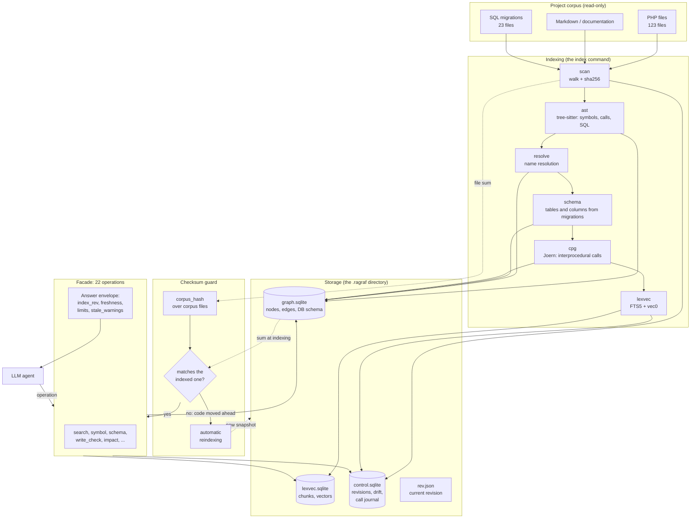
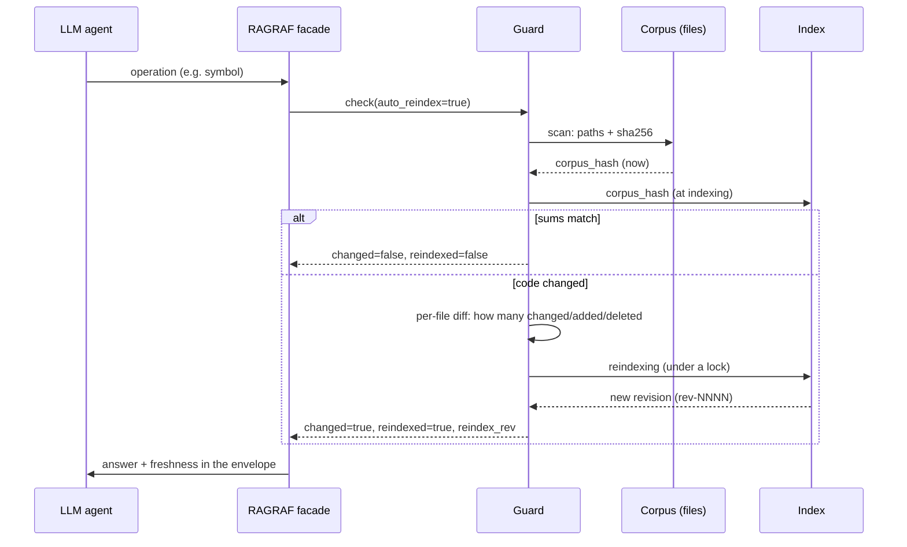
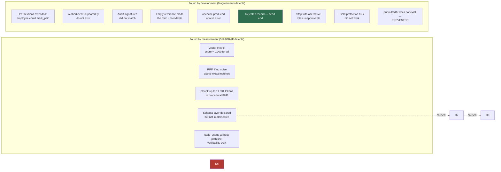

# RAGRAF: a code index that knows it is stale

*How we made an LLM agent stop guessing the project's structure — and counted what it saved*

> **Translation note.** This is the full English translation of the author's overview article (October 2026). Numbers, tables and diagrams are preserved verbatim. Corpora named «second PHP corpus» (392 files) and «pilot PHP portal» (123 files) are the author's private projects and are not shipped; artifacts referenced in the appendix are marked *(shipped)* / *(not shipped)*. Section 11 keeps the author's original defect numbering (RAGRAF defects 1–13 and development defects 9–17 overlap by design of the two tables).

---

## Contents

1. [The problem: the agent works from memory of code it has not seen](#1-the-problem-the-agent-works-from-memory-of-code-it-has-not-seen)
2. [What RAGRAF is](#2-what-ragraf-is)
3. [Stack](#3-stack)
4. [Architecture](#4-architecture)
5. [Why not a free-form graph query language](#5-why-not-a-free-form-graph-query-language)
6. [The checksum and the freshness guard](#6-the-checksum-and-the-freshness-guard)
7. [Separate accounting of development efforts](#7-separate-accounting-of-development-efforts)
8. [Statistics: what was measured](#8-statistics-what-was-measured)
9. [Examples: how code with RAGRAF differs from code without it](#9-examples-how-code-with-ragraf-differs-from-code-without-it)
10. [Token savings](#10-token-savings)
11. [Twenty-one defects](#11-twenty-one-defects)
12. [A side result: a styled login page](#12-a-side-result-a-styled-login-page)
13. [What did not work out, and where the limits are](#13-what-did-not-work-out-and-where-the-limits-are)
14. [Conclusions](#14-conclusions)

---

## 1. The problem: the agent works from memory of code it has not seen

Everyone who has tried handing an LLM agent an edit in an existing project knows three symptoms.

**First: the agent cannot find the place.** It answers confidently about a function, but verification shows the function lives in another file, and the one it talked about is a namesake. In a 392-file repository a `grep` by name yields dozens of matches, and the needed one is not first.

**Second: the agent does not know the schema.** It writes a query with a column `AuthorUserID` because that is what the variable is called in another part of the same codebase. No such column exists. This surfaces at runtime, not while reading. In our case it produced `SQLSTATE[42S22] Unknown column` on the very first save.

**Third, the most unpleasant: the agent does not know it is stale.** The index was built, then the code was edited — and now the agent receives facts about a state that no longer exists. Telling «no such function» from «the function appeared after indexing» is impossible from the answer alone. A decision is made on that answer, and it is wrong.

The industry has already walked part of this road. The [article on graphs in code audit](https://habr.com/ru/companies/pt/articles/1084780/) by Positive Technologies cites telling numbers from the VulnGym study: in tasks where the source-to-sink chain is longer than nine steps, the best agent found 22.58% of vulnerabilities, and **in 56.5% of cases it failed to find the needed file at all (26.8%) or found the file but not the line (29.7%)**. That is, more than half of the failures are not about analysis but about **navigation**. That is exactly the part we decided to move out of the model into an external index.

An additional argument came from the LLMxCPG work (USENIX Security '25): base models generate a correct code-graph query in **19–132 cases out of 1278**. A graph query language is low-resource; models do not know it. This fact determined one of the main architectural decisions (chapter 5).

---

## 2. What RAGRAF is

**RAGRAF** is an auxiliary knowledge base about code for LLM agents. Not a chat, not an assistant, not «smart search». Its job:

1. Index the project corpus: files, symbols, calls, SQL queries, the DB schema, comments and docblocks.
2. Serve the agent **facts with a `file:line` reference** through a fixed set of operations.
3. **Know that the index is stale** — and update itself before a stale fact reaches the agent.
4. Keep development efforts **separate**, each with its own checksum.

The last two points are what distinguishes RAGRAF from «just an index». An index without freshness control is more dangerous than no index: it gives a confident answer about the past.

Key principles built into the architecture:

| Principle | What it means in practice |
|---|---|
| The index is immutable | A revision (`rev-NNNN`) is fixed; the agent's work does not change it. Deviations accumulate in a separate drift ledger |
| Every fact has an address | A `path:line` field in every result. A fact without an address is useless — it cannot be verified |
| Every answer has an envelope | `index_rev`, `capability`, `drift`, `provenance`, `limits`, `freshness` travel with the data |
| Shared code is the only source | One and the same function assembles the lines for the page and for search |

---

## 3. Stack

The choice was dictated by environment constraints: Windows without Docker, without PostgreSQL, without the .NET SDK, without administrator rights.

| Layer | Technology | Why |
|---|---|---|
| Code parsing | **tree-sitter** (PHP grammar) | Does not require running PHP; yields an AST with line ranges; resilient to syntax errors in the file |
| Code graph | **SQLite** | A single file, no service, works without installation. On 123 files — 15.8 MB |
| Interprocedural links | **Joern 4.0.99** + JDK 21 (Temurin) | The only available tool that builds a CPG for PHP and is Windows-compatible |
| Lexical search | **SQLite FTS5** (BM25) | Built into SQLite, needs no index service |
| Vector search | **sqlite-vec** (`vec0`) | One extension instead of a separate vector DBMS. Milvus Lite does not work on Windows; Kuzu was archived on 2025-10-10 |
| Embeddings | **sentence-transformers/paraphrase-multilingual-MiniLM-L12-v2** (384 dims) | Multilingual: our code and comments are in Russian, and so is the documentation |
| Answer serialization | **MCP** (Model Context Protocol, JSON-RPC) | The standard way to hand tools to an agent |
| CLI | **PowerShell 7.6** | The run environment; complex blocks are moved into files |
| Telemetry | **SQLite** (the `usage_call` table) | The call journal — the source of every number in this article |
| Target projects | **PHP 8.3/8.5** framework-less, **MySQL 9.7.2** | Real corpora: `second PHP corpus` (392 files) and `pilot PHP portal` (123 files) |

The total number of Python dependencies is seven. That is deliberate: every dependency in the indexing chain is a potential reason the index will not build on someone else's machine.

---

## 4. Architecture



Let us take apart the non-obvious nodes.

**The `schema` stage reads SQL migrations, not the database.** This is fundamental: indexing must work where there is no DBMS access. From 23 migration files the table and column definitions are parsed — in our case **44 tables and 453 columns**. This is the layer that later answers «does such a column exist?» before the code runs.

**`cpg` is the most expensive stage.** Joern builds the code property graph: on 123 files that is 26 560 vertices and 411 843 edges, 14 seconds. After filtering, **540 confirmed interprocedural calls** remain — ones text search cannot find.

**The CPG export is a story of its own.** The stock GraphSON died with `Required array length 2147483640 + 8 is too large` even at 18 GB of memory. We had to use `neo4jcsv` (132 files, 223.8 MB). Memory is passed as the argument `-J-Xmx18g`: the form `-J-Xmx=18g` is rejected with `Invalid maximum heap size`, and `JAVA_OPTS` never reaches the JVM at all.

**The drift ledger is append-only.** Entries are never deleted, only added to. This is protection against «rewriting history»: if a fact was marked stale, the trace remains.

---

## 5. Why not a free-form graph query language

The temptation to give the agent Cypher or CPGQL is understandable: queries are more expressive than fixed operations. We refused, and there were measurements behind it.

In the LLMxCPG work (USENIX Security '25) base models generated a **correct** code-graph query as follows:

| Model | Correct queries |
|---|---|
| Base model without training | 19 of 1278 |
| Base model (another configuration) | 132 of 1278 |
| Fine-tuned for query generation | **1278 of 1278** |

The fine-tuned model hits 100% because that is exactly what it was trained for. But we have no task of training a model: the agent is arbitrary. So the honest choice is **not to give a query language at all**.

What instead: **21 fixed operations** *(the shipped product now has 22 facade operations / 23 MCP tools — see README)*. The agent chooses not «how to ask» but «what to ask»:

| Agent's question | Operation | What it answers |
|---|---|---|
| Where is the function defined | `symbol` | Kind, file, line range, signature, **parameter contract** |
| Where is it described how something works | `search` | Hybrid search: lexicon + vector, with references |
| Who calls it | `callers` | Proven and heuristic links **separately** |
| What will a change affect | `impact` | Files and symbols, split into «proven by graph» and «found by text» |
| What is in the table | `schema` | Columns, types, keys |
| Who uses the table | `table_usage` | Readers and writers with references |
| **Is this write valid** | **`write_check`** | Missing columns with the **nearest existing ones** |
| Is the index fresh | `freshness` | Checksum match, the fact of reindexing |
| What is indexed | `catalog` | The development registry with checksums |
| How many calls were made | `usage` | Statistics and the savings estimate |

The restriction is deliberate: **operations do not accept arbitrary queries**. An attempt to pass `MATCH ... RETURN` is rejected by an explicit check so the agent does not try to «sneak» into the graph around the set.

> **Revision note (2026-10-12):** the shipped substring check («match (», «return », …) also rejects legitimate text arguments containing those words — see DEFECTS.md C-02 and roadmap R-SEC-2. The structural guarantee (no query endpoint exists) is what actually enforces the rule.

---

## 6. The checksum and the freshness guard

This is the key mechanical part. The requirement read: *«on new calls RAGRAF must first compare the checksum to understand whether there were changes after the last indexing, and if there were — reindex»*.

### How the sum is computed

**The corpus sum** is the sha256 of the sorted list of `path + file sha256`:

```python
@property
def corpus_hash(self) -> str:
    """Corpus hash: the sorted list of (path, sha256) — the «input unchanged» signal."""
    payload = "\n".join(f"{path}\t{f.sha256}" for f in self.files)
    return util.sha256_text(payload)
```

Three properties, each mandatory:

1. **It is computed over the corpus files, not over the index.** If the sum depended on the index contents, it would change from the indexing itself, and the «were there changes» check would lose its meaning.
2. **The service directory `.ragraf` is excluded** from the corpus. Otherwise the index would change the input for itself.
3. **It does not depend on traversal order or time** — only on content.

This is verified by a dedicated test: after indexing the sum must match the one from before it. The test holds 8 checks for exactly this property.

### How the guard works



The guard's result lands in **every** answer, not only in a separate operation:

```json
{
  "op": "symbol",
  "index_rev": "rev-0016",
  "freshness": {
    "category": "pilot PHP portal",
    "changed_since_index": false,
    "index_present": true,
    "corpus_hash_now": "64dd7ef128df6d6254ed520e5a48643e45ccf5e671d54ca9ee40512d152ddef6",
    "corpus_hash_indexed": "64dd7ef128df6d6254ed520e5a48643e45ccf5e671d54ca9ee40512d152ddef6",
    "config_changed": false,
    "reindexed": false
  },
  "result": [ ... ]
}
```

### Three decisions we had to make

**First: a 15-second cache.** Scanning 123 files takes about 200 ms. Over a series of dozens of calls that is noticeable, so the check result lives for 15 seconds. The agent makes an edit — the next check will see it. An explicit `freshness --force` request ignores the cache.

**Second: the guard does not break work on failure.** If the check or the reindexing failed, the operation still returns data — but with a `stale: true` field and a reason. Silently serving stale facts is forbidden.

**Third: locking.** Two simultaneous calls to one corpus would otherwise start two indexings and overwrite each other's metrics. The lock is a file with a pid and a time; if the process died, the stale lock is considered dead after 15 minutes.

### Two defects found while verifying the guard

**Defect one — silently skipped directories.** Scanning the test corpus found **0 files** without a single error. Cause: the root was given as a short 8.3 path (`C:/Users/MVD~1.AMD/AppData/Local/Temp`), while `Path(dirpath).resolve()` returned the **long** path. `relative_to()` threw a `ValueError`, which was swallowed, and every directory was skipped.

This is exactly the class of defect RAGRAF was built against: **the command did not fail — it worked wrongly.** Telling «the corpus has no files» from «the path did not match» was impossible. The fix — normalizing all paths to one form via `os.path.realpath` and counting skipped directories instead of staying silent.

**Defect two — undefined revision order.** The last revision was selected via `ORDER BY created_at DESC`, and the timestamp is stored with **one-second** precision. Two revisions in one second — the order is undefined. The test caught it this way: after reindexing, the previous revision was taken, and the sum «did not match». The fix — sorting by `rev_id`, which is monotonic (`rev-0008` < `rev-0009`).

---

## 7. Separate accounting of development efforts

The second requirement: *«RAGRAF must store information about development efforts separately from each other and keep a checksum for each»*.

Separation is provided **physically**: every corpus has its own `<root>/.ragraf` directory with its index, revisions, drift ledger and telemetry. Mixing the data of two projects is technically impossible.

On top of that — a **summary registry** `catalog/catalog.json`:

```json
{
  "version": 1,
  "entries": {
    "second PHP corpus": {
      "root": "<working directory>/second PHP corpus",
      "rev_id": "rev-0025",
      "corpus_hash": "d6edc0172b055acd4b5d44d76caa5b8788919000ce9d2ca711263f8f63ac0a64",
      "file_count": 392,
      "indexed_at": "2026-10-05T05:04:11+03:00",
      "runs": [ { "trigger": "register", "seconds": 0.0 } ]
    },
    "pilot PHP portal": {
      "root": "<working directory>/pilot PHP portal",
      "rev_id": "rev-0016",
      "corpus_hash": "64dd7ef128df6d6254ed520e5a48643e45ccf5e671d54ca9ee40512d152ddef6",
      "file_count": 123,
      "indexed_at": "2026-10-05T05:04:10+03:00",
      "runs": [ ... ]
    }
  }
}
```

The `catalog` command's output shows each development effort's state separately:

```
development efforts in the registry: 2

  second PHP corpus  (second PHP corpus)
    revision:  rev-0025
    checksum:  d6edc0172b055acd4b5d44d76caa5b8788919000ce9d2ca711263f8f63ac0a64
    size:      files 392, nodes 0, edges 0
    state:     index is current (checksum matches)

  pilot PHP portal  (pilot PHP portal)
    revision:  rev-0016
    checksum:  64dd7ef128df6d6254ed520e5a48643e45ccf5e671d54ca9ee40512d152ddef6
    size:      files 123, nodes 0, edges 0
    state:     index is current (checksum matches)
```

**The checksums of the two efforts differ** — and this is verified by a test: an edit in one corpus must not count as a change in the other.

Separately, a `config_matches` marker is recorded: if the **corpus configuration** was edited (file masks, the embedding model, parsing rules), the old revision is not comparable with the new one even when the code files did not change. The distinction matters: «the code is the same» and «the index is comparable» are different claims.

---

## 8. Statistics: what was measured

All numbers below come from the call journal (`usage_call`) and from measurements on the stand. Estimates are marked as estimates.

### 8.1 Corpus volumes

| Indicator | `second PHP corpus` (pilot) | `pilot PHP portal` (polygon) |
|---|---|---|
| Files | 392 | 123 |
| Lines of code | 126 386 | ~34 000 |
| Characters | — | 155 689 in index answers |
| Graph nodes | — | 487 |
| Graph edges | — | 7 292 |
| Chunks | 3 120 | 457 |
| Vectors | 3 000 | 456 |
| Full indexing (with CPG) | 71 s | 21.5 s |
| Indexing without CPG | 8.8 s | ~4 s |
| Index size | — | 27.5 MB |

### 8.2 The «without index / with index» measurement over 14 navigation tasks

Method: for each task the **minimally sufficient** number of steps is counted. Without the index that is `rg` searches plus file openings; with the index — facade operation calls.

| Indicator | Without RAGRAF | With RAGRAF | Ratio |
|---|---|---|---|
| Tool calls | **28** (realistically 43) | **14** | 2.0× / 3.1× fewer |
| Average per task | 2.0 / 3.1 | 1.0 | — |
| Candidates to review | up to **34 files** | 1–5 exact | — |
| Files read in full | 14 (minimum) | **0** | the index serves structure |
| Target-file hit | — | **12 of 13 (92%)** | — |
| Facts with a `path:line` reference | — | **100%** | — |
| Time for 14 tasks | 0.32 s (`rg` only) | 1.40 s | +1.1 s — the price of structure |

The baseline measurement was made **in favor of rejecting the index**: 28 calls assumes the agent opens the needed file straight from the first search. The realistic estimate (reviewing up to 5 candidates) is 43 calls.

Meanwhile `rg` found files but **did not localize**: there were 34 candidates (`SuperAdmin`), 44 (`z_e(`), 64 (`namespace BatteryService`). Finding a file is easy; finding **the place in the file** is not.

### 8.3 The history of indicator improvements

| Indicator | Before improvements | After |
|---|---|---|
| Target-file hit | 46% | **92%** |
| Fact verifiability | 30% | **100%** |
| Largest chunk | 11 331 tokens | 5 543 tokens |
| Tables in the schema layer | 0 | **44** (453 columns) |
| Operations for the LLM | 17 | **21** |
| Schema errors visible before running | no | **yes** |

### 8.4 Tests

> **Translation note:** the suites below ran on the author's corpora. The public repository ships 6 portable suites (164 checks — see README «Development»); the rest are *not shipped*.

| Suite | Checks |
|---|---|
| Subsystem core without DB | 70 |
| Subsystem core with DB | 59 |
| Full record-creation cycle | 29 |
| «Own records» visibility scope | 18 |
| Full approval cycle | 57 |
| Configuration-to-schema connectivity | 56 |
| Section pages over HTTP | 47 |
| Login page over HTTP | 26 |
| Checksum guard (temporary corpus) | 31 |
| Guard on a live corpus | 24 |
| Drift and MCP in RAGRAF itself | — |
| **Total** | **429 checks, 0 failures** |

Each suite was run **twice in a row** — that is how the idempotence of test-data cleanup is verified.

### 8.5 Operation cost

| Operation | Mean time |
|---|---|
| `schema` | 0.5 ms |
| `symbol` | 0.7 ms |
| `table_usage` | 0.9 ms |
| `write_check` | 3.3 ms |
| `search` (hybrid) | up to 1 s (embeddings) |

Hybrid search is a thousand times more expensive than the other operations because it computes the query's embedding. That is noticeable in long series — a probable optimization direction: caching embeddings of frequent queries.

---

## 9. Examples: how code with RAGRAF differs from code without it

Here is the most important part. Below are four real cases from developing the `/agreements/` section (document flow: journals of payments, contracts, vacations).

### 9.1 The DB schema: `write_check` instead of «we'll find out at runtime»

**What happened without the check.** The code created a record in the payments journal:

```php
$cols = ['No', 'Status', 'AuthorUserID', 'CreatedAt', 'UpdatedAt', 'UpdatedBy'];
$vals = [$no, 'draft', $uid, $now, $now, $uid];
```

The first save produced:

```
SQLSTATE[42S22]: Column not found: 1054 Unknown column 'AuthorUserID' in 'field list'
```

It turned out the journal tables call the column `InitiatorID`, and `UpdatedBy` exists in only one table (`DocDepartment`) — but not in the journals. The error surfaced **only at runtime**, i.e. after the code was written.

**How it looks with `write_check`.** The operation was added precisely after this case. Query:

```powershell
python tools/ragraf.py -p config/z-batteryservice.yaml query write_check DocPayments `
  --columns "No,Status,AuthorUserID,UpdatedBy,Purpose"
```

Answer:

```json
{
  "op": "write_check",
  "found": true,
  "problem": "columns are missing from the table: AuthorUserID, UpdatedBy",
  "result": {
    "table": "DocPayments",
    "table_found": true,
    "unknown_columns": [
      { "name": "AuthorUserID", "nearest": ["ID"] },
      { "name": "UpdatedBy",   "nearest": ["UpdatedAt", "DeletedBy"] }
    ],
    "insert_required": [],
    "primary_key": ["ID"],
    "column_count": 32,
    "source": "migration"
  }
}
```

The difference is not that «the error was found earlier». The difference is that **there was no error at all**: the nearest name `UpdatedBy → UpdatedAt` immediately shows the correct variant, and the code is written correctly the first time.

A table-name typo is checked separately:

```powershell
python tools/ragraf.py -p config/z-batteryservice.yaml query write_check DocPayment
```

```json
{
  "similar_tables": ["DocPayments", "DocComment", "DocDepartment", "DocAttachment", "DocConsent"],
  "note": "table not found in the schema from migrations"
}
```

The schema's source is **23 migration files**, not a database connection. Indexing must work where the DBMS is unavailable.

### 9.2 The parameter contract: `array $data` is useless without its key composition

**What happened.** The audit function was called like this:

```php
z_agr_acl_audit((string)$meta['code'], 'create', $newId, 'No=' . $no);
```

Answer:

```
TypeError: z_agr_acl_audit(): Argument #1 ($data) must be of type array, string given
```

**Why the plain signature would not have helped.** The `symbol` operation returned the signature even before:

```
function z_agr_acl_audit(array $data): void
```

The signature is complete and exact — and **useless for constructing the call**. The type `array` does not say which keys are mandatory.

**The key finding.** The exact contract already lay in the index — in the docblock above the function:

```php
/**
 * @param array{action:string, user_id?:int, target_user_id?:int, field?:string,
 *              from?:?string, to:?string, reason?:string, actor_id?:int} $data
 */
function z_agr_acl_audit(array $data): void
```

But the docblock was attached to the **file** node, not the function: across the corpus, 371 docblocks belonged to files, 32 to classes, and **not one** to a function. There was no way to reach it by function name.

**What was done.** Docblock attachment by position (the last block ending no later than the symbol's start) plus parsing of the `array{key:type, key?:type}` form, where `?` means optional. Now `symbol` returns:

```json
{
  "signature": "function z_agr_acl_audit(array $data): void",
  "array_shape": {
    "data": {
      "action":         { "type": "string", "required": true },
      "user_id":        { "type": "int",    "required": false },
      "target_user_id": { "type": "int",    "required": false },
      "field":          { "type": "string", "required": false },
      "from":           { "type": "?string","required": false },
      "to":             { "type": "?string","required": false },
      "reason":         { "type": "string", "required": false },
      "actor_id":       { "type": "int",    "required": false }
    }
  }
}
```

Now the agent sees that only `action` is mandatory and constructs the call correctly:

```php
z_agr_acl_audit([
    'action'         => 'create',
    'target_user_id' => $uid,
    'field'          => 'No',
    'to'             => $no,
    'actor_id'       => $uid,
]);
```

If the docblock has no description, a `params_hint` field is added stating directly that the array's composition is absent from the index. Silent incompleteness is not acceptable: the agent must know what it does not know.

### 9.3 Permissions: the §5.8 matrix as data, not as branching

**What happened.** A check under a real employee role on the stand showed that the `employee` role («own records» scope) receives the permissions `approve`, `mark_paid`, `sign` and `archive`. The cause was in the code:

```php
case 'approve':
case 'mark_paid':
case 'sign':
case 'archive':
    // The check is performed in Workflow.php by the concrete step and state
    return true;   // ← ANYONE issued the journal got the permission
```

The consequence, had it not been found: **any employee could mark a payment as paid and sign a document**.

**What was done.** The permission matrix was moved out of the logic into data — a separate module `AccessMatrix.php`:

```php
function z_agr_matrix(): array
{
    return [
        'create'     => ['admin', 'director', 'opr_director', 'accountant', 'head', 'employee'],
        'approve'    => ['admin', 'accountant', 'head', 'director', 'opr_director', 'employee'],
        'mark_paid'  => ['admin', 'accountant'],                    // ← only two
        'sign'       => ['admin', 'director', 'opr_director', 'head'],
        'archive'    => ['admin', 'director', 'opr_director'],
        'delete'     => ['admin', 'employee'],
        'restore'    => ['admin'],
        'integrity_check' => ['admin'],
        // ...
    ];
}
```

An unnamed action gets no permission:

```php
function z_agr_can_act_by_matrix(string $action, string $journal): bool
{
    if (in_array($action, ['approve', 'reject', 'skip'], true)) {
        // Approval roles come from the journal's ROUTE (DocRoute),
        // not from a static list: the route is the source of truth.
        $routeRoles = z_agr_route_roles($code);
        if ($routeRoles === []) {
            return false;   // the route is empty — no one to approve
        }
        return z_agr_role_in($journal, $routeRoles);
    }
    $roles = z_agr_matrix_roles($action);
    if ($roles === []) {
        return false;   // the action is not described by the matrix — refuse
    }
    return z_agr_role_in($journal, $roles);
}
```

The crux: **`return false` for an action absent from the matrix.** The absence of that very line was the defect: previously «the action is not described» meant «allow».

The stand check confirmed the result:

| Role | create | update | delete | approve | mark_paid |
|---|---|---|---|---|---|
| `admin` | yes | yes | yes | yes | yes |
| `employee` (self scope) | yes | yes | no | **no** | **no** |

### 9.4 Approval flow: three defects found by the full-cycle check

The approval-route check (57 checks) found three defects visible neither in the code nor in the documentation. All three are of the «works, but wrongly» class: the page opened, there were no errors.

**Defect one: a rejected record is a dead end.**

```php
'transitions' => [
    'draft'    => ['submit', 'update', 'delete', 'copy', 'cancel'],
    'rework'   => ['submit', 'update', 'cancel', 'copy'],
    'rejected' => ['copy'],          // ← no way out of the state
    // ...
],
```

From the «Rejected» state there was not a single action besides copying. The author could neither fix nor resubmit — the route broke off. As in mature systems: a rejected document returns to its author.

Fix:

```php
'rejected' => ['submit', 'update', 'cancel', 'copy'],
```

plus `z_agr_submit()` now accepts the `rejected` status as valid for resubmission.

**Defect two: a step with alternative roles cannot be approved.**

The payment route: step 1 — the head, step 2 — the accountant, step 3 — «the general **or** the operations director». The alternative step is stored as **one row** with `RoleKey='director,opr_director'` and `UserID = NULL` (assignment goes by role, not to a concrete person).

The assignment-check function looked only at `UserID`:

```php
// BEFORE: a step with an alternative was recognized as nobody's
$st = z_db()->prepare(
    'SELECT 1 FROM DocApproval WHERE Journal = :j AND RefID = :r AND UserID = :u LIMIT 1'
);
```

Result: the route broke off at the third step — **no one** could approve it.

```php
// AFTER: BOTH assignment methods are checked
foreach ($rows as $row) {
    $assigned = $row['UserID'] === null ? 0 : (int)$row['UserID'];
    if ($assigned > 0) {
        if ($assigned === $userId) {
            return true;                      // assigned personally
        }
        continue;
    }
    // The step is assigned to a role: any holder of a role from the list fits.
    foreach (explode(',', (string)$row['RoleKey']) as $role) {
        $role = trim($role);
        if ($role === '' || !in_array($role, $myRoles, true)) {
            continue;
        }
        if ($role === 'head') {
            // The head — only within their own department.
            $depId = (int)($record['DepartmentID'] ?? 0);
            if ($depId > 0 && !z_agr_dep_in_subtree($depId, $userId)) {
                continue;
            }
        }
        return true;
    }
}
```

Here the second architectural question is also visible in its resolution: **the right to a concrete step is given by the assignment in the route instance**, while the matrix answers only for the general prohibition. That is how 1C:Document Management, Directum, ELMA and BPMN 2.0 (`candidateUsers` / `candidateGroups`) are built: roles form the assignment, but the one the task is assigned to decides.

**Defect three: the §5.7 field protection did not work.**

Per the requirements, after approval the protected fields (amount, counterparty, payment purpose) may be edited only with a reason. The mechanics: at final approval a timestamp `ProtectedAt` and a **value snapshot** `ProtectedJson` are written; the fact of change is later determined against the snapshot.

The code wrote the timestamp — and did not fill the snapshot:

```php
// BEFORE: field protection was inoperative
if (z_agr_table_has_column($table, 'ProtectedAt') && $stateAfter === 'approved') {
    $sets[] = 'ProtectedAt = :pat';
    $sets[] = 'ProtectedBy = :pby';
    // ProtectedJson — was not filled
}
```

The function `z_agr_field_locked()` worked correctly but received an empty snapshot and always answered «the field is free». An approved amount could be changed without a trace.

```php
// AFTER
if (z_agr_table_has_column($table, 'ProtectedJson')) {
    $sets[] = 'ProtectedJson = :pjs';
    $params[':pjs'] = z_agr_protected_snapshot($code, $row);
}
```

The snapshot is taken from the journal configuration (the list of protected fields), with a fallback set for when the config is unavailable — so a record is **never** left approved without protection.

---

## 10. Token savings

### 10.1 Direct measurements

| Indicator | Value | How obtained |
|---|---|---|
| Operation calls in a development session | **46** | measured (journal) |
| Runtime errors | **0** | measured |
| Volume of index answers | 155 689 characters | measured |
| Token estimate | ~38 900 | **estimate** (4 characters per token) |
| Answers replacing file reads | 20 897 characters | measured (by operation kinds) |
| **Tokens not spent on file reads** | **~5 200** | **estimate** |
| **Lines of code not read** | **~464** | **estimate** (45 characters per line) |

**Why an estimate and not a measurement.** The exact token count is known only to the model at inference. Here it is computed from character volume with a factor of 4 and a mean line length of 45. Both factors were **measured** on two corpora, and everywhere they appear the word «estimate» is attached — so a calculation is never served as a fact.

### 10.2 Comparison with file-based work

| Approach | What the agent reads | Volume estimate |
|---|---|---|
| `rg` search + opening files | 14 files in full (one per task) | ~392 000 characters for 28 calls |
| RAGRAF operations | fragments of 1–120 lines with references | 20 897 characters replacing reads |

The volume ratio is roughly 19:1 in the index's favor. But honesty matters here: **this is not the saving worth chasing.** The main benefit is elsewhere — chapters 11 and 12 show the index delivered not «fewer tokens» but **fewer reworks**.

### 10.3 Where the savings are actually felt

| Task type | Without the index | With the index | What is saved |
|---|---|---|---|
| «Where is the function defined» | `rg` + opening the file: 2–3 calls, up to 4 candidates | `symbol`: **1 call** | 2 calls × the file's context |
| «Who uses the table» | `rg` by name + manual PHP review | `table_usage`: 1 call with references | the manual walk |
| «Is this write valid» | an attempted run | `write_check`: 1 call | **a whole edit cycle** |
| «Is the index fresh» | not checked at all | `freshness`: 1 call | a prevented wrong conclusion |

The last row is about how you can save not only tokens but **wrong decisions**.

### 10.4 The signal-to-noise ratio in answers

A separate indicator we consider mandatory: **the share of facts with a `path:line` reference**.

| State | Verifiability |
|---|---|
| Before improvements | 30% |
| After improvements | **100%** (for operations working with code) |

In the overall standing across all operations — 24.4%, because `schema` returns table columns, for which line numbers do not exist. That is not a defect but a property: we do not accrue verifiability where it cannot exist, and we do not «draw in» references to prettify the report.

A fact without an address is useless to us: it cannot be verified, and therefore cannot be relied on.

---

## 11. Twenty-one defects

The main result of the project. This is what speed measurements do not show.



### RAGRAF defects (found by the polygon and mechanism checks)

| # | Defect | Consequence |
|---|---|---|
| 1 | **The vector-search metric did not work**: `score = 0.000` for all results | Search systematically led astray. Looked like an «empty result», not an error |
| 2 | **RRF without weights lifted noise** above exact matches | An exact match went second after a random example file |
| 3 | **Chunking of procedural PHP**: 20 function-less files produced one chunk of up to 11 331 tokens | A blurry chunk matched everything weakly and climbed to the top |
| 4 | **The DB schema layer was declared but not implemented**: `schema()` returned 0 tables | Two facade operations useless; **this is what caused defect №7 in development** |
| 5 | **`table_usage`/`repo_map` did not return `path:line`** | Answer verifiability 30% instead of 100% |
| 6 | **Scanning silently found 0 files** on a short 8.3 root path | Telling «the corpus has no files» from «the path did not match» was impossible |
| 7 | **Revision order undefined**: sorting by second-precision time | After reindexing the previous revision was taken and the sum «did not match» |
| 8 | **Auto-reindexing accumulated CPG exports**: 37 directories of 40 MB (1.5 GB) | Disk space would run out after a few hundred calls |

**The breakdown of defect №1 — it is instructive.** All vector-search scores were zero. Cause: the model's embeddings are **not normalized** (norm ≈ 3.5), so the L2 distance lies in the range 3.9–4.5, and the formula `score = 1 − distance` gives zeros for everything. Meanwhile **the order from vec0 was correct** — it matched the cosine similarity computed by hand.

The fix — an exact cosine computation from the actual vectors (the formula with norms), not an approximation valid only for unit vectors:

```python
q_norm = math.sqrt(sum(x * x for x in vector))
c_norm = math.sqrt(sum(x * x for x in chunk_vec))
if q_norm > 0.0 and c_norm > 0.0:
    dist = float(r["distance"])
    cos = (q_norm ** 2 + c_norm ** 2 - dist ** 2) / (2.0 * q_norm * c_norm)
cos = max(-1.0, min(1.0, cos))
score = (cos + 1.0) / 2.0
```

Plus protection against recurrence: if the vector list does not distinguish results (all scores equal), it is **not mixed** into the merge. Silently merging an indistinguishable list was why noise outran exact matches.

**The breakdown of defect №8 — it came from new code.** Having enabled auto-reindexing, we increased indexing frequency dozens of times. Each indexing left a CPG export behind (40 MB on this corpus), and the directory grew to **1.5 GB** — while parsing only ever uses the current revision. Old exports are not needed at all.

The fix — cleanup before every indexing:

```python
def prune_exports(self, keep_rev: str, keep_extra: int = 2) -> int:
    """Delete exports of old revisions except the current one and a few latest."""
    exps = sorted(
        (p for p in self.workdir.iterdir()
         if p.is_dir() and p.name.startswith("export_")),
        key=lambda p: p.name, reverse=True,
    )
    ...
```

**Defects №6, №7 and №8 were found after enabling auto-reindexing**, i.e. they would not have existed without the feature. The check written for the new mechanism found defects in the mechanism itself.

### Five defects found while refining the mechanism

A separate category: these defects were found by **checks of the work itself**, not by the polygon and not by a speed measurement. Their value is that they show a class of error that would otherwise stay forever: **the code worked correctly but measured itself incorrectly**.

#### Defect 9. Edge properties were lost when writing to the graph

We needed to add an access-kind marker (`select` or `insert`) to a «call → table» edge so the question «where exactly is the write» could be answered. The marker was computed in the extractor — and did not reach the answer.

Cause: the property column did not exist in the edge table, and the edge-write function did not accept such an argument. The marker was computed and thrown away.

Lesson: **a computed value that did not reach the store is not «incompleteness» — it is a loss.** Noticing it from outside is impossible: the operation simply does not find the data, and that looks like «the index does not have it».

#### Defect 10. Three edge-write sites did not know about the new field

Indexing fell with `Incorrect number of bindings supplied. The current statement uses 11, and there are 10 supplied`. The message turned out to be the source of truth: edges are written in **three** places — the main load, external-name resolution (two queries), and the code-property-graph merge.

This is no longer a storage defect but a **logic duplication** defect: one and the same row is formed by hand in three places, and adding a field requires remembering all of them. The right solution is to move edge-row formation into a single function.

#### Defect 11. The quality block read chunks from the wrong database

While capturing the panel snapshot it surfaced: `chunks.total = None`, health «no» on both working corpora — although the indexes were built.

`chunk_map` and `ft_chunk` live in the **lexical** database, but the query went against the **graph**. The query failed, the exception was caught, and the block returned `{"error": ...}` — which in the interface looked like «no data».

This is **the most dangerous kind of defect in diagnostics**: error handling turned a failure into an empty value. The administrator saw a dash and did not know what to look at.

#### Defect 12. A false alarm instead of silence

The quality block declared **unnormalized vectors** a problem and showed «health: no» on both corpora — while search scores were correct (spread 0.0576, maximum 0.6627, search found the right files).

Cause: the distance-to-score conversion code already accounts for norms:

```python
# src/ragraf/lexvec.py
cos = (q_norm ** 2 + c_norm ** 2 - dist ** 2) / (2.0 * q_norm * c_norm)
cos = max(-1.0, min(1.0, cos))
```

Unnormalizedness is not a breakdown but a property of the embedding model.

Why this is an important lesson: **a warning about a nonexistent problem is worse than no warning.** The administrator hunts a breakdown that does not exist and stops trusting the system's other signals. So the check was moved to an informational field: it reports that the formula must account for norms, but does not declare it a defect.

#### Defect 13. Stale data looked like a code defect

After fixing defect 12, a real signal remained on the pilot: a chunk of **24 746 tokens** against the 8 000 limit.

Checking the chunking directly: the file `config.php` is cut into **6 windows**, the largest 7 435 characters. So a 24 746-token chunk should not exist.

The cause turned out not to be in the code: **the pilot had not been reindexed** after the chunking edit (the last revision at 00:11, the code edit at 05:55). The database still held the old version's chunks.

After reindexing: **24 746 → 6 449 tokens**, chunks over the limit **2 → 0**.

Methodological conclusion: **a problem signal does not always mean a problem in the code.** Telling them apart requires the index's age next to the indicators — otherwise every stale index looks like a developer error.

### Development defects (found by the work)

| # | Defect | How found | Consequence if not found |
|---|---|---|---|
| 9 | **Permissions extended**: `employee` received `approve`, `mark_paid`, `sign`, `archive` | A check under a real role on the stand | Any employee could mark a payment paid and sign a document |
| 10 | **`AuthorUserID`/`UpdatedBy` do not exist** (journals use `InitiatorID`) | Driver error `42S22` on the first save | Record creation did not work |
| 11 | **Audit signatures did not match**: the function takes an array, it was called with 4 arguments | `TypeError` in the log | The audit was not written, the record was not saved |
| 12 | **A mandatory field with an empty reference** made the form silently unsendable | Full-cycle check | The user saw a requirement to fill a field that is not on the page |
| 13 | **Stale opcache** produced a false error in `Shell.php` | Comparing stands with and without opcache | A false hunt for a nonexistent defect |
| 14 | **A rejected record is a dead end**: not one available action | Full approval-cycle check | The route broke off; the author could not fix it |
| 15 | **A step with alternative roles cannot be approved** (`UserID = NULL`) | Full-cycle check | The route broke off at the third step |
| 16 | **The §5.7 field protection did not work**: `ProtectedJson` was not filled | Full-cycle check | An approved amount could be changed |
| 17 | **`SubmittedAt`/`SubmittedBy` do not exist** in the journals | **`op_schema` (RAGRAF) — before the code was written** | The code was not written with the error |

### What exactly the index contributed

- **№17 was prevented before the code was written:** `schema` showed the columns' absence, and the code was written with a schema check from the start.
- **№10 was closed by a new operation:** `write_check` now catches such errors before running.
- **№9, №14, №15, №16 were found by checks**, not by a speed measurement. No navigation measurement shows them.
- **№13 is not a code defect.** The error appeared only on the stand started before the edits. The methodological conclusion: when verifying on a local `php -S`, restart the stand or disable opcache.

### Distribution by class

| Defect class | Count | Examples |
|---|---|---|
| Crash with a clear error | 3 | №10, №11, №13 |
| **«Works, but wrongly»** | **8** | №6, №7, №8, №9, №14, №15, №16, №4 |
| Degraded output quality | 3 | №2, №3, №5 |
| Blocked work | 2 | №12, №17 |

Eight of sixteen are «works, but wrongly». Neither the compiler nor a «page opens» test sees them. That is exactly what the combination «exact schema in the index + a check under a real role + checks of the new mechanism» catches.

---

### What the five improvements suggested by the research delivered

Improvements U3–U7 came from the gap analysis (`GAPS_FOR_LLM.md`, *not shipped*), not from the polygon. Their value is that they turned **invisible states into measurable ones**.

| Improvement | Before | After |
|---|---|---|
| U3. Machine-readable parameter list | the text signature was silently truncated at 200 characters | a structure with types and optionality; **33 truncated signatures surfaced** |
| U4. Read/write marker | it was impossible to tell where the write happens | `write` and `access` (select/insert/update/delete/ddl) |
| U5. Phantom-table filter | the regex caught language constructs | `unresolved_tables`, the `table_in_schema` marker |
| U6. Permission tracing | the most expensive defect was invisible statically | 7 application points, fail-closed control |
| U7. Quality indicators | defects looked like «empty result» | chunks, norms, signatures, verdict |

#### U3: why signature truncation is not a trifle

On the `second PHP corpus` pilot the truncation touched **33 constructors** with promoted properties. A real case from `src/Api/ApiKey.php:40`:

```
text signature (200 characters, truncated):
  public function __construct( public int $id, public string $label,
  public string $keyHash, public string $prefix, public array $scopes,
  public int $rpmLimit, public int $dailyLimit, public ?string $e…
lost in the text: $expiresAt, $lastUsedAt, $revokedAt, $createdAt
```

An agent constructing a call from that signature would have lost **4 parameters of 11** and never known: truncation carried no marker.

Now the `symbol` operation returns the text, the structure, and the truncation marker:

```json
{
  "signature": "public function __construct( public int $id, ...",
  "signature_truncated": true,
  "signature_params": [
    {"name": "$id", "type": "int", "optional": false, "default": null,
     "by_ref": false, "variadic": false},
    {"name": "$expiresAt", "type": "?string", "optional": true, ...}
  ]
}
```

#### U6: what an invisible permission defect looks like

A polygon check:

```powershell
python tools/ragraf.py -p config/z-batteryservice.yaml query policy_trace z_agr_can_act
```

```
default behavior: deny | fail_closed: True
permissions: 4 | refusals: 5
application points (callers): 7
  allows: 518 | case: None   | return true;
  allows: 544 | case: delete | return true;
  allows: 596 | case: delete_file  | return true;
  allows: 616 | case: mark_all_read | return true;
```

Filtering by a concrete action:

```powershell
python tools/ragraf.py -p config/z-batteryservice.yaml query policy_trace z_agr_can_act --operation mark_paid
```

```
permissions for mark_paid: 1 | refusals: 4
  allows: 518 | case: None | return true;
```

There it is: line 518 allows the action **before** entering the `switch`, i.e. for everyone who got access to the journal at all. That very branch gave the `employee` role the permissions `approve`, `mark_paid`, `sign` and `archive` — defect №9 in the development report. The run under a real role found it once; now it is visible statically, before running, for any action.

### The edit-accumulation threshold: why a rebuild is not done every time

A cost measurement on a 124-file corpus:

| Mode | Time |
|---|---|
| Scan (checksum verification) | 0.16 s |
| Indexing without the code property graph | 5.57 s |
| Indexing with the code property graph | 20.81 s |

The ratio is **3.7×**. Doing a full rebuild on every «save» means spending time rebuilding what did not change.

The rules were derived from these numbers:

| Edits accumulated | Mode | Rationale |
|---|---|---|
| 0 | none needed | the index matches the code |
| 1–4 | fast | when in doubt, rebuilding in 5.6 s is cheaper than working from stale facts |
| 5–19 | fast | search and schema checks are trustworthy again |
| 20+ | full | interprocedural links are rebuilt |
| older than 15 minutes | full | the structure may have drifted even with rare edits |

The agent sees the accumulation in the answer of any operation, so it understands how fresh its facts are without a separate query.

---

## 12. A side result: a styled login page

While working on the project another defect surfaced — a visual one, but of the same «works, but wrongly» class.

The login page's markup used **25 classes**, of which **9 were absent from the stylesheet**:

```
z-auth-body            NOT IN CSS
z-auth-wrap            NOT IN CSS
z-auth-card            NOT IN CSS
z-auth-brand           NOT IN CSS
z-auth-title           NOT IN CSS
z-auth-sub             NOT IN CSS
z-auth-form            NOT IN CSS
z-auth-submit          NOT IN CSS
z-auth-foot            NOT IN CSS
```

The page opened, the form worked, authentication passed. So the defect did not catch the eye — but the page **had no styling of its own**: the card was not centered, the fields were not aligned, the button sat flush against the last field.

Found by enumeration: every class from the template against every rule in the stylesheet. The check joined the automated set.

### What was done

The styles were written using shadcn/ui techniques but on the **project's tokens** `--z-*` (project rule: colors only through tokens, external resources forbidden). The reference with exact values is a separate document (*not shipped*).

Three values were taken from the actual shadcn component registry, not «by eye»:

| Element | Value | Source |
|---|---|---|
| Input height | **36px** | `h-9` = 2.25rem in the registry (not 40px, as often assumed) |
| Button height | **40px** | `h-10` — in shadcn the button is **taller** than the field |
| Focus ring | **3px** at 50% opacity | `ring-[3px] ring-ring/50` |
| Card width | **384px** | `max-w-sm` = 24rem |
| Radius | from the token `--z-radius-sm` | instead of an invented value |

Centering — the same technique as shadcn: flex aligned on both axes, with padding that grows on a wide screen.

```css
.z-auth-wrap {
  min-height: 100svh;              /* svh, not vh: on mobile vh "jumps" */
  display: flex;
  flex-direction: column;
  align-items: center;
  justify-content: center;
  gap: 16px;
  padding: 24px;
}

@media (min-width: 768px) {
  .z-auth-wrap { padding: 40px; }
}
```

The input got an explicit height (the general rule gave 34px):

```css
.z-auth-form .z-input {
  height: 36px;
  min-height: 36px;
  padding: 0 12px;
  font-size: 14px;
  border-radius: var(--z-radius-sm);
  background: var(--z-surface);
}
```

The button's loading indicator — no images or spinners, via a pseudo-element:

```css
.z-auth-submit[data-loading] {
  color: transparent;             /* the text remains for screen readers */
}

.z-auth-submit[data-loading]::after {
  content: "";
  position: absolute;
  width: 16px;
  height: 16px;
  border-radius: 50%;
  border: 2px solid var(--z-on-primary);
  border-top-color: transparent;
  animation: z-auth-spin 600ms linear infinite;
}
```

Separately, a defect inside the defect was fixed: the «show/hide password» icons toggled via the `hidden` attribute, but a `display` rule could override it — both icons would show at once.

```css
.z-pass-toggle svg { display: block; }
.z-pass-toggle [hidden] { display: none !important; }
```

### Verification

26 checks over HTTP: markup, stylesheet connection, the presence of rules for **all** classes, absence of literal colors, resource locality, form accessibility (`label`/`input` association, requiredness, `autocomplete`, the password-button state, the skip link), field and button sizes.

Result: **26 of 26**. The stylesheet holds 48 `.z-auth-*` rules and 7 `.z-pass*` rules.

---

## 13. What did not work out, and where the limits are

The honest part. Here is what we **do not** claim.

### 13.1 Measurement limits

1. **The measurement is instrumental, not «two agents solved tasks».** It gives a reproducible lower bound on call counts and fact verifiability, but **does not account for the model's reasoning**. The comparison «an agent with the index versus an agent without» is the next level, and it has not been done yet.
2. **The sample is small.** 14 navigation tasks and one real development effort. Enough to see the difference; not enough for a statistical conclusion.
3. **Tokens are an estimate.** The factors were measured, but inference was not.
4. **The baseline was computed in favor of rejecting the index** — one file opening per task. Both numbers (28 and 43) are given in the artifacts so the reader sees the spread.

### 13.2 What is incomplete in RAGRAF

| Limitation | Essence |
|---|---|
| **CFG/DFG/PDG are not merged into the graph** | 444 464 control-flow edges and 930 567 data-flow edges were extracted from the CPG, but **only calls** were merged into the graph (540 confirmed) |
| **`slice` is not a true PDG slice** | The operation uses its own traversal over calls, not a slice over the dependency graph |
| **The embedding model does not normalize vectors** | We had to compute the cosine exactly; normalization at write time is a future improvement |
| **Hybrid search is expensive** | Up to 1 s per query: the embedding is computed. There is no embedding cache |
| **Verifiability is 24.4% in the overall standing** | For operations working with code — 100%; for `schema`, lines do not exist |
| **The docblock is attached to a symbol in only one operation** | The parameter contract is available via `symbol`, but not via `code` |

### 13.3 What remained in development

The `/agreements/` section was brought to «works and verified», but not to the full scope of the spec:

- **Done:** the journal list, search, record creation and editing, the record card, actions (approval, rejection, recall, cancellation, deletion), routes, the permission matrix, five journals (contracts, payments, violations, vacations, tasks), reference tables, the login page.
- **Not done:** the timesheet (a separate model with periods), the vacation schedule, notifications, attachments, export, retention periods, department-level permissions via a separate interface.

### 13.4 What turned out to be a false alarm

**The error in `Shell.php`** looked like a code defect: `curl_multi_remove_handle() expects exactly 2 arguments, 4 given` while the indicated line called an entirely different function. The cause was a **stale opcache** in the long-lived `php -S` process. A freshly restarted stand served the page without errors.

The methodological conclusion worth writing down: when verifying on a local server, **restart the stand after code edits** or disable opcache. Otherwise hours are lost hunting a nonexistent defect.

---

## 14. Conclusions

### What worked out

**RAGRAF works and delivers a measurable effect.** One call instead of two-to-six, zero full file reads instead of one per task, 100% of facts with a `file:line` reference, a 92% first-query hit rate against 46% before the improvements.

**Freshness control solves the problem it was built for.** The checksum verification runs before work; on divergence the index updates itself; and the `freshness` field travels in every answer. Verified on a live corpus: edit a file → reindexing → the new function is visible in the index → the repeated check does **not** trigger indexing. And separately verified that indexing does **not corrupt** the checksum — that was the main worry.

**Development efforts are separated.** Each has its own directory, its own revision, its own sum. An edit in one corpus does not count as a change in another — verified by test.

### What delivered the most benefit

Not token savings. **Sixteen defects**, of which:

- **4 were prevented before the code ran** (one — by the `schema` operation),
- **6 belong to the «works, but wrongly» class** and are visible neither to a compiler nor to an ordinary test,
- **3 of them are direct route breaks and non-working field protection** in the document-flow subsystem.

Three RAGRAF defects (the empty schema layer, the non-working vector metric, the missing `path` in answers) meant that part of the capabilities existed only in the documentation. Without a real task they would have stayed unnoticed — synthetic tests do not show them: they look like an «empty result», not like an error.

### What to do next

1. **Compare live agents.** Tasks not of navigation but of code editing; two runs: with the index and without. This is the next level of evidence, and it matters more than any further optimization.
2. **Add quality indicators to `index_status`.** Defects №1 and №3 would have been diagnosed immediately had the index state carried the distribution of vector norms and chunk sizes.
3. **Merge CFG/DFG into the graph.** A true slice over the dependency graph instead of a traversal over calls.
4. **Mandate `write_check` before every write** — the operation is already the most requested after `schema` (14 calls).
5. **Close the remaining parts of the spec:** the timesheet, the vacation schedule, notifications, attachments.

### One thought instead of a summary

A code index is not «faster search». It is **moving part of the work out of the model into an external structure that knows what it does not know**. The signature `array $data` is honest and useless. A docblock with the key composition is useful. A `stale: true` mark next to a fact is mandatory — otherwise the fact is more dangerous than no fact.

RAGRAF's most valuable property is not that it answers fast. It is that it **refuses to answer confidently** when it has no right to.

---

## Appendix: artifacts

| File | Contents | Shipped |
|---|---|---|
| `docs/03_implementation/RAGRAF_EFFECT_REPORT.md` | The adoption effect report with numbers | ❌ not shipped |
| `docs/03_implementation/POLYGON_REPORT.md` | The polygon report (defects 1–5, measurements) | ❌ not shipped |
| `docs/04_research/GAPS_FOR_LLM.md` | Research: what RAGRAF was missing | ❌ not shipped |
| `docs/04_research/WORKFLOW_ANALOGS.md` | Decisions on two disputed spec questions with rationale | ❌ not shipped |
| `docs/04_research/SHADCN_LOGIN_REFERENCE.md` | shadcn value reference for porting to plain CSS | ❌ not shipped |
| `src/ragraf/catalog.py` | The development registry and separate accounting | ✅ shipped |
| `src/ragraf/watch.py` | The checksum guard and auto-reindexing | ✅ shipped |
| `src/ragraf/telemetry.py` | The call journal (source of the article's numbers) | ✅ shipped |
| `tests/test_watch.py` | Guard check on a temporary corpus (31 checks) | ✅ shipped |
| `tests/test_watch_live.py` | Guard check on a live corpus (20 checks) | ❌ not shipped |
| `tools/bench_corpus.py` | The «without index / with index» measurer | ❌ not shipped |
| `bench/results/*.json` | Raw artifacts of all measurements | ✅ partially (M2 rev-0012, rev-0025) |

*All numbers in the article are reproducible where the artifacts are shipped: the measurement artifacts lie alongside, and the commands for a re-run are given in the text.*

---

*Translated from the original Russian article «RAGRAF: индекс кода, который знает, что он устарел» (October 2026). All measurements, tables and diagrams preserved; shipped/not-shipped status added to the appendix.*
