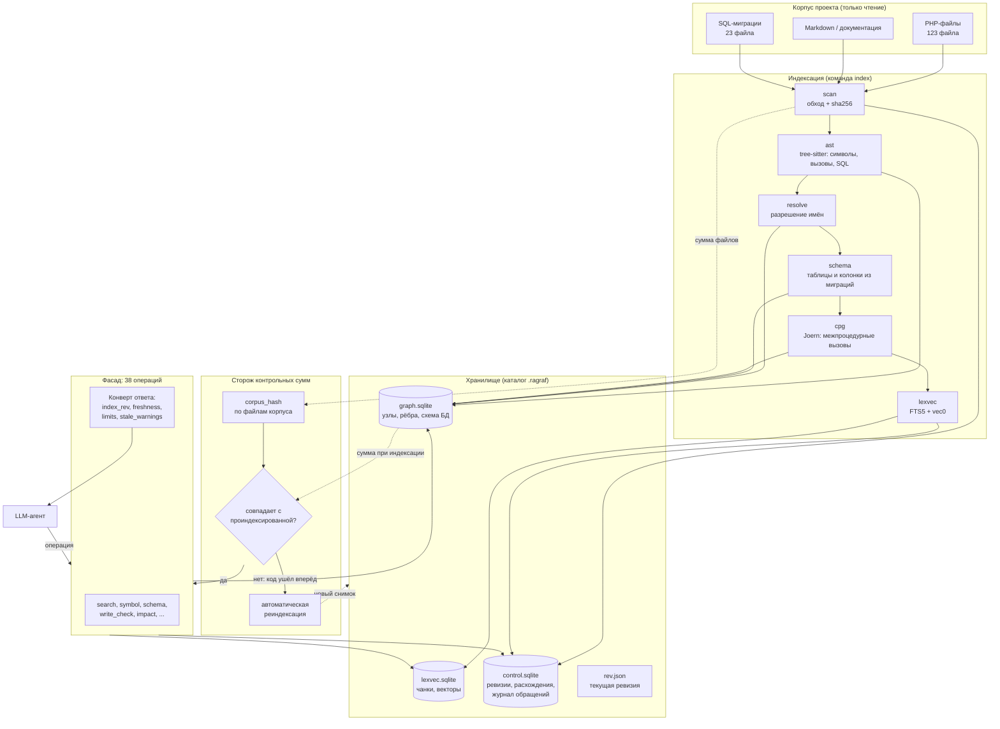
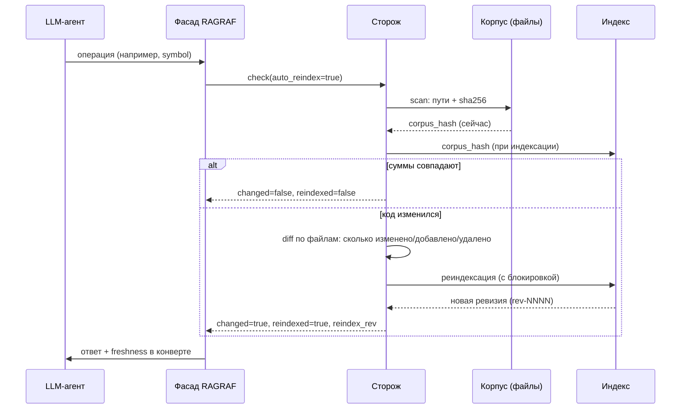
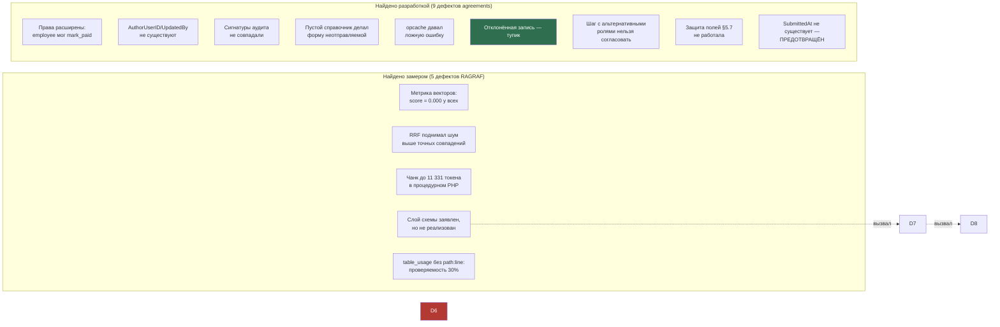

# RAGRAF: индекс кода, который знает, что он устарел

*Как мы заставили LLM-агента перестать угадывать устройство проекта и посчитали, сколько это сэкономило*

---

## Оглавление

1. [Проблема: агент работает по памяти о коде, которого не видел](#1-проблема-агент-работает-по-памяти-о-коде-которого-не-видел)
2. [Что такое RAGRAF](#2-что-такое-ragraf)
3. [Стек](#3-стек)
4. [Архитектура](#4-архитектура)
5. [Почему не свободный язык запросов к графу](#5-почему-не-свободный-язык-запросов-к-графу)
6. [Контрольная сумма и сторож свежести](#6-контрольная-сумма-и-сторож-свежести)
7. [Раздельный учёт разработок](#7-раздельный-учёт-разработок)
8. [Статистика: что замерено](#8-статистика-что-замерено)
9. [Примеры: чем код с RAGRAF отличается от кода без него](#9-примеры-чем-код-с-ragraf-отличается-от-кода-без-него)
10. [Экономия токенов](#10-экономия-токенов)
11. [Двадцать один дефект](#11-двадцать-один-дефект)
12. [Побочный результат: оформленная страница входа](#12-побочный-результат-оформленная-страница-входа)
13. [Что не получилось и где границы](#13-что-не-получилось-и-где-границы)
14. [Выводы](#14-выводы)

---

## 1. Проблема: агент работает по памяти о коде, которого не видел

Каждый, кто пробовал поручать LLM-агенту правку в существующем проекте, знает три симптома.

**Первый: агент не находит место.** Он уверенно отвечает про функцию, но при проверке выясняется, что функция в другом файле, а та, о которой он говорил, — одноимённая. На репозитории в 392 файла поиск `grep` по имени выдаёт десятки совпадений, и нужное среди них не первое.

**Второй: агент не знает схемы.** Он пишет запрос с колонкой `AuthorUserID`, потому что так названа переменная в другой части того же кода. Колонки с таким именем нет. Это выясняется при запуске, а не при чтении. В нашем случае это дало `SQLSTATE[42S22] Unknown column` на первом же сохранении.

**Третий, самый неприятный: агент не знает, что устарел.** Индекс был построен, потом код правили — и дальше агент получает факты о состоянии, которого уже нет. Отличить «такой функции нет» от «функция появилась после индексации» по ответу невозможно. Решение принимается по этому ответу, и оно неверно.

Индустрия уже прошла часть этого пути. В [статье про графы в аудите кода](https://habr.com/ru/companies/pt/articles/1084780/) из Positive Technologies приведены показательные числа исследования VulnGym: в задачах, где цепочка от источника до стока длиннее девяти шагов, лучший агент находил 22,58% уязвимостей, а **в 56,5% случаев он вообще не находил нужный файл (26,8%) или находил файл, но не строку (29,7%)**. То есть больше половины отказов — не про анализ, а про **навигацию**. Именно эту часть мы и решили вынести из модели во внешний индекс.

Дополнительный аргумент дала работа LLMxCPG (USENIX Security '25): базовые модели генерируют корректный запрос к графу кода в **19–132 случаях из 1278**. Язык запросов к графу — низкоресурсный, модели его не знают. Этот факт определил одно из главных архитектурных решений (глава 5).

---

## 2. Что такое RAGRAF

**RAGRAF** — вспомогательная база знаний о коде для LLM-агентов. Не чат, не ассистент, не «умный поиск». Его работа:

1. Проиндексировать корпус проекта: файлы, символы, вызовы, SQL-запросы, схему базы, комментарии и docblock'и.
2. Отдавать агенту **факты со ссылкой `файл:строка`** через фиксированный набор операций.
3. **Знать, что индекс устарел**, и обновляться самому — до того, как агенту отдадут устаревший факт.
4. Хранить разработки **раздельно**, с контрольной суммой по каждой.

Последние два пункта — то, что отличает RAGRAF от «просто индекса». Индекс без контроля свежести опаснее, чем отсутствие индекса: он даёт уверенный ответ о прошлом.

Ключевые принципы, заложенные в архитектуру:

| Принцип | Что это значит на практике |
|---|---|
| Индекс неизменяем | Ревизия (`rev-NNNN`) фиксируется; работа агента её не меняет. Отклонения копятся в отдельном журнале расхождений |
| У каждого факта есть адрес | Поле `path:line` в каждом результате. Факт без адреса бесполезен — его нельзя проверить |
| У каждого ответа есть конверт | `index_rev`, `capability`, `drift`, `provenance`, `limits`, `freshness` едут вместе с данными |
| Общий код — единственный источник | Одна и та же функция собирает строки для страницы и для поиска |

---

## 3. Стек

Выбор продиктован ограничениями среды: Windows без Docker, без PostgreSQL, без .NET SDK, без прав администратора.

| Слой | Технология | Почему так |
|---|---|---|
| Разбор кода | **tree-sitter** (грамматика PHP) | Не требует запускать PHP; даёт AST с диапазонами строк, устойчив к синтаксическим ошибкам в файле |
| Граф кода | **SQLite** | Единый файл, нет сервиса, работает без установки. На 123 файлах — 15,8 МБ |
| Межпроцедурные связи | **Joern 4.0.99** + JDK 21 (Temurin) | Единственный доступный инструмент, который строит CPG для PHP и совместим с Windows |
| Лексический поиск | **SQLite FTS5** (BM25) | Встроен в SQLite, не требует индекса-сервиса |
| Векторный поиск | **sqlite-vec** (`vec0`) | Одно расширение вместо отдельной векторной СУБД. Milvus Lite на Windows не работает, Kuzu заархивирован 10.10.2025 |
| Эмбеддинги | **sentence-transformers/paraphrase-multilingual-MiniLM-L12-v2** (384 измерения) | Мультиязычная: код и комментарии у нас на русском, документация тоже |
| Сериализация ответов | **MCP** (Model Context Protocol, JSON-RPC) | Штатный способ отдать инструменты агенту |
| CLI | **PowerShell 7.6** | Среда Run; сложные блоки выносятся в файлы |
| Телеметрия | **SQLite** (таблица `usage_call`) | Журнал обращений — источник всех чисел этой статьи |
| Целевые проекты | **PHP 8.3/8.5** без фреймворка, **MySQL 9.7.2** | Реальные корпуса: `revoap.com` (392 файла) и `z.batteryservice.ru` (123 файла) |

Общее число зависимостей Python — семь. Это сознательно: каждая зависимость в цепочке индексации — потенциальная причина, по которой индекс не соберётся на чужой машине.

---

## 4. Архитектура



Разберём узлы, которые неочевидны.

**Стадия `schema` читает SQL-миграции, а не базу.** Это принципиально: индексация должна работать там, где нет доступа к СУБД. Из 23 файлов миграций разбираются определения таблиц и колонок — в нашем случае **44 таблицы и 453 колонки**. Именно этот слой потом позволяет ответить на вопрос «а такая колонка существует?» до запуска кода.

**`cpg` — самая дорогая стадия.** Joern строит граф свойств кода: на 123 файлах это 26 560 вершин и 411 843 ребра, 14 секунд. Из них после фильтрации остаётся **540 подтверждённых межпроцедурных вызовов** — их текстовый поиск найти не может.

**Экспорт CPG — отдельная история.** Штатный GraphSON падал с `Required array length 2147483640 + 8 is too large` даже при 18 ГБ памяти. Пришлось использовать `neo4jcsv` (132 файла, 223,8 МБ). Память при этом передаётся аргументом `-J-Xmx18g`: форма `-J-Xmx=18g` отвергается с `Invalid maximum heap size`, а `JAVA_OPTS` до JVM не доходит вообще.

**Журнал расхождений — append-only.** Записи не удаляются, только дополняются. Это защита от «переписывания истории»: если факт был помечен устаревшим, след остаётся.

---

## 5. Почему не свободный язык запросов к графу

Соблазн дать агенту Cypher или CPGQL понятен: запросы выразительнее фиксированных операций. Мы отказались, и на это были измерения.

В работе LLMxCPG (USENIX Security '25) базовые модели генерировали **корректный** запрос к графу кода так:

| Модель | Верных запросов |
|---|---|
| Base-модель без обучения | 19 из 1278 |
| Base-модель (другая конфигурация) | 132 из 1278 |
| Дообученная для генерации запросов | **1278 из 1278** |

Дообученная модель — 100%, потому что её учили именно этому. Но у нас нет задачи обучать модель: агент произвольный. Значит, честный выбор — **не давать язык запросов вовсе**.

Что вместо этого: **21 фиксированная операция**. Агент выбирает не «как спросить», а «что спросить»:

| Вопрос агента | Операция | Что отвечает |
|---|---|---|
| Где определена функция | `symbol` | Вид, файл, диапазон строк, сигнатура, **контракт параметров** |
| Где описано, как устроено | `search` | Гибридный поиск: лексика + вектор, со ссылками |
| Кто вызывает | `callers` | Доказанные и эвристические связи **раздельно** |
| Что затронет изменение | `impact` | Файлы и символы, разделённые на «доказано графом» и «найдено текстом» |
| Что в таблице | `schema` | Колонки, типы, ключи |
| Кто использует таблицу | `table_usage` | Читатели и писатели со ссылками |
| **Можно ли так записать** | **`write_check`** | Отсутствующие колонки с **ближайшими существующими** |
| Свежий ли индекс | `freshness` | Совпадение контрольной суммы, факт реиндексации |
| Что проиндексировано | `catalog` | Реестр разработок с суммами |
| Сколько было обращений | `usage` | Статистика и оценка экономии |

Ограничение сознательное: **операции не принимают произвольных запросов**. Попытка передать `MATCH ... RETURN` отвергается явной проверкой, чтобы агент не пытался «пролезть» в граф в обход набора.

---

## 6. Контрольная сумма и сторож свежести

Это ключевая механическая часть. Требование звучало так: *«при новых обращениях RAGRAF сначала сверял контрольную сумму, чтобы понять, были изменения или нет после последней индексации, и если были — делал реиндексацию»*.

### Как считается сумма

**Сумма корпуса** — sha256 от отсортированного списка `путь + sha256 файла`:

```python
@property
def corpus_hash(self) -> str:
    """Хэш корпуса: отсортированный список (путь, sha256) — признак «вход не менялся»."""
    payload = "\n".join(f"{f.path}\t{f.sha256}" for f in self.files)
    return util.sha256_text(payload)
```

Три свойства, каждое из которых обязательно:

1. **Считается по файлам корпуса, а не по индексу.** Если бы сумма зависела от содержимого индекса, она менялась бы от самой индексации, и проверка «были изменения» теряла бы смысл.
2. **Служебный каталог `.ragraf` исключён** из корпуса. Иначе индекс менял бы вход сам для себя.
3. **Не зависит от порядка обхода и времени** — только от содержимого.

Проверяется это отдельным тестом: после индексации сумма обязана совпасть с той, что была до неё. Тест находит 8 проверок ровно на это свойство.

### Как работает сторож



Результат сторожа попадает в **каждый** ответ, а не только в отдельную операцию:

```json
{
  "op": "symbol",
  "index_rev": "rev-0016",
  "freshness": {
    "category": "z.batteryservice.ru",
    "changed_since_index": false,
    "index_present": true,
    "corpus_hash_now": "64dd7ef128df6d6254ed520e5a48643e45ccf5e671d54ca9ee40512d152ddef6",
    "corpus_hash_indexed": "64dd7ef128df6d6254ed520e5a48643e45ccf5e671d54ca9ee40512d152ddef6",
    "config_changed": false,
    "reindexed": false
  },
  "result": [ ... ]
}
```

### Три решения, которые пришлось принять

**Первое: кэш на 15 секунд.** Сканирование 123 файлов — около 200 мс. При серии из десятков обращений это заметно, поэтому результат проверки живёт 15 секунд. Агент делает правку — следующая проверка её увидит. Явный запрос `freshness --force` кэш игнорирует.

**Второе: сторож не ломает работу при сбое.** Если проверка или реиндексация упала, операция всё равно отдаёт данные — но с полем `stale: true` и причиной. Молчаливая выдача устаревших фактов запрещена.

**Третье: блокировка.** Два одновременных обращения к одному корпусу иначе запустят две индексации и перезапишут показатели. Блокировка — файл с pid и временем; если процесс упал, старая блокировка считается мёртвой через 15 минут.

### Два дефекта, найденных при проверке сторожа

**Дефект первый — молчаливый пропуск каталогов.** Сканирование тестового корпуса находило **0 файлов** без единой ошибки. Причина: корень был задан коротким 8.3-путём (`C:/Users/MVD~1.AMD/AppData/Local/Temp`), а `Path(dirpath).resolve()` возвращал **длинный** путь. `relative_to()` выбрасывал `ValueError`, который глушился, и каждый каталог пропускался.

Это ровно тот класс дефектов, против которого RAGRAF и создавался: **команда не упала, а сработала не так**. Отличить «в корпусе нет файлов» от «путь не совпал» было невозможно. Исправление — приведение всех путей к одной форме через `os.path.realpath` и подсчёт пропущенных каталогов вместо молчания.

**Дефект второй — неопределённый порядок ревизий.** Выбор последней ревизии шёл через `ORDER BY created_at DESC`, а метка времени хранится с точностью **до секунды**. Две ревизии в одну секунду — порядок неопределён. Тест поймал это так: после реиндексации бралась прежняя ревизия, и сумма «не совпадала». Исправление — сортировка по `rev_id`, который монотонен (`rev-0008` < `rev-0009`).

---

## 7. Раздельный учёт разработок

Второе требование: *«чтобы RAGRAF хранил информацию о разработках отдельно друг от друга и хранил контрольные суммы по каждой»*.

Разделение обеспечено **физически**: у каждого корпуса свой каталог `<корень>/.ragraf` с индексом, ревизиями, журналом расхождений и телеметрией. Смешать данные двух проектов технически невозможно.

Поверх этого — **сводный реестр** `catalog/catalog.json`:

```json
{
  "version": 1,
  "entries": {
    "revoap.com": {
      "root": "C:/AutoClaw/revoap.com",
      "rev_id": "rev-0025",
      "corpus_hash": "d6edc0172b055acd4b5d44d76caa5b8788919000ce9d2ca711263f8f63ac0a64",
      "file_count": 392,
      "indexed_at": "2026-10-05T05:04:11+03:00",
      "runs": [ { "trigger": "register", "seconds": 0.0 } ]
    },
    "z.batteryservice.ru": {
      "root": "C:/AutoClaw/z.batteryservice.ru",
      "rev_id": "rev-0016",
      "corpus_hash": "64dd7ef128df6d6254ed520e5a48643e45ccf5e671d54ca9ee40512d152ddef6",
      "file_count": 123,
      "indexed_at": "2026-10-05T05:04:10+03:00",
      "runs": [ ... ]
    }
  }
}
```

Вывод команды `catalog` показывает состояние каждой разработки отдельно:

```
разработок в реестре: 2

  revoap.com  (revoap.com)
    ревизия:  rev-0025
    сумма:    d6edc0172b055acd4b5d44d76caa5b8788919000ce9d2ca711263f8f63ac0a64
    размер:   файлов 392, узлов 0, рёбер 0
    состояние: индекс актуален (сумма совпадает)

  z.batteryservice.ru  (z.batteryservice.ru)
    ревизия:  rev-0016
    сумма:    64dd7ef128df6d6254ed520e5a48643e45ccf5e671d54ca9ee40512d152ddef6
    размер:   файлов 123, узлов 0, рёбер 0
    состояние: индекс актуален (сумма совпадает)
```

**Контрольная сумма у разработок разная** — и это проверяется тестом: правка в одном корпусе не должна считаться изменением в другом.

Отдельно фиксируется признак `config_matches`: если правили **конфигурацию корпуса** (маски файлов, модель эмбеддингов, правила разбора), старая ревизия несопоставима с новой, даже когда файлы кода не менялись. Это отличие важно: «код тот же» и «индекс сопоставим» — разные утверждения.

---

## 8. Статистика: что замерено

Все числа ниже получены из журнала обращений (`usage_call`) и из замеров на стенде. Оценки помечены как оценки.

### 8.1 Объём корпусов

| Показатель | `revoap.com` (пилот) | `z.batteryservice.ru` (полигон) |
|---|---|---|
| Файлов | 392 | 123 |
| Строк кода | 126 386 | ~34 000 |
| Символов | — | 155 689 в ответах индекса |
| Узлов графа | — | 487 |
| Рёбер графа | — | 7 292 |
| Чанков | 3 120 | 457 |
| Векторов | 3 000 | 456 |
| Полная индексация (с CPG) | 71 с | 21,5 с |
| Индексация без CPG | 8,8 с | ~4 с |
| Размер индекса | — | 27,5 МБ |

### 8.2 Замер «без индекса / с индексом» по 14 задачам навигации

Методика: для каждой задачи считается **минимальное достаточное** число шагов. Без индекса это поиски `rg` плюс открытия файлов; с индексом — вызовы операций фасада.

| Показатель | Без RAGRAF | С RAGRAF | Отношение |
|---|---|---|---|
| Вызовов инструментов | **28** (реалистично 43) | **14** | 2,0× / 3,1× меньше |
| Среднее на задачу | 2,0 / 3,1 | 1,0 | — |
| Кандидатов к просмотру | до **34 файлов** | 1–5 точных | — |
| Файлов читается целиком | 14 (минимум) | **0** | индекс отдаёт структуру |
| Попадание в файл-цель | — | **12 из 13 (92%)** | — |
| Факты со ссылкой `path:line` | — | **100%** | — |
| Время на 14 задач | 0,32 с (только `rg`) | 1,40 с | +1,1 с — плата за структуру |

Замер baseline сделан **в пользу отказа от индекса**: 28 вызовов — это если агент с первого поиска сразу открывает нужный файл. Реалистичная оценка (просмотр до 5 кандидатов) — 43 вызова.

При этом `rg` находил файлы, но **не локализовал**: кандидатов было 34 (`SuperAdmin`), 44 (`z_e(`), 64 (`namespace BatteryService`). Найти файл легко, найти **место в файле** — нет.

### 8.3 История улучшения показателей

| Показатель | До улучшений | После |
|---|---|---|
| Попадание в файл-цель | 46% | **92%** |
| Проверяемость фактов | 30% | **100%** |
| Крупнейший чанк | 11 331 токен | 5 543 токена |
| Таблиц в слое схемы | 0 | **44** (453 колонки) |
| Операций для LLM | 17 | **21** |
| Ошибки схемы видны до запуска | нет | **да** |

### 8.4 Тесты

| Набор | Проверок |
|---|---|
| Ядро подсистемы без БД | 70 |
| Ядро подсистемы с БД | 59 |
| Полный цикл создания записи | 29 |
| Область видимости «свои записи» | 18 |
| Полный цикл согласования | 57 |
| Связность конфигураций со схемой | 56 |
| Страницы раздела через HTTP | 47 |
| Страница входа через HTTP | 26 |
| Сторож контрольных сумм (временный корпус) | 31 |
| Сторож на живом корпусе | 24 |
| Дрейф и MCP в самом RAGRAF | — |
| **Итого** | **429 проверок, 0 провалов** |

Прогон каждого набора выполнен **дважды подряд** — так проверяется идемпотентность уборки тестовых данных.

### 8.5 Стоимость операций

| Операция | Среднее время |
|---|---|
| `schema` | 0,5 мс |
| `symbol` | 0,7 мс |
| `table_usage` | 0,9 мс |
| `write_check` | 3,3 мс |
| `search` (гибридный) | до 1 с (эмбеддинги) |

Гибридный поиск в тысячу раз дороже остальных операций, потому что считает эмбеддинг запроса. Это заметно на длинных сериях — вероятное направление оптимизации: кэш эмбеддингов частых запросов.

---

## 9. Примеры: чем код с RAGRAF отличается от кода без него

Здесь самое важное. Ниже — четыре реальных случая из разработки раздела `/agreements/` (документооборот: журналы платежей, договоров, отпусков).

### 9.1 Схема базы: `write_check` вместо «узнаем при запуске»

**Что случилось без проверки.** Код создавал запись в журнале платежей:

```php
$cols = ['No', 'Status', 'AuthorUserID', 'CreatedAt', 'UpdatedAt', 'UpdatedBy'];
$vals = [$no, 'draft', $uid, $now, $now, $uid];
```

Первое сохранение дало:

```
SQLSTATE[42S22]: Column not found: 1054 Unknown column 'AuthorUserID' in 'field list'
```

Оказалось, в таблицах журналов колонка называется `InitiatorID`, а `UpdatedBy` есть только у одной таблицы (`DocDepartment`) — но не у журналов. Ошибка проявилась **только при запуске**, то есть после написания кода.

**Как это выглядит с `write_check`.** Операция добавлена именно после этого случая. Запрос:

```powershell
python tools/ragraf.py -p config/z-batteryservice.yaml query write_check DocPayments `
  --columns "No,Status,AuthorUserID,UpdatedBy,Purpose"
```

Ответ:

```json
{
  "op": "write_check",
  "found": true,
  "problem": "колонки отсутствуют в таблице: AuthorUserID, UpdatedBy",
  "result": {
    "table": "DocPayments",
    "table_found": true,
    "unknown_columns": [
      { "name": "AuthorUserID", "nearest": ["ID"] },
      { "name": "UpdatedBy",   "nearest": ["UpdatedAt", "DeletedBy"] }
    ],
    "insert_required": [],
    "primary_key": ["ID"],
    "column_count": 32,
    "source": "migration"
  }
}
```

Разница не в том, что «ошибку нашли раньше». Разница в том, что **ошибки не было вовсе**: ближайшее имя `UpdatedBy → UpdatedAt` сразу показывает правильный вариант, и код пишется верно с первого раза.

Отдельно проверяется опечатка в имени таблицы:

```powershell
python tools/ragraf.py -p config/z-batteryservice.yaml query write_check DocPayment
```

```json
{
  "similar_tables": ["DocPayments", "DocComment", "DocDepartment", "DocAttachment", "DocConsent"],
  "note": "таблица не найдена в схеме из миграций"
}
```

Источник схемы — **23 файла миграций**, а не подключение к базе. Индексация обязана работать там, где СУБД недоступна.

### 9.2 Контракт параметров: `array $data` бесполезен без состава ключей

**Что случилось.** Функция аудита вызывалась так:

```php
z_agr_acl_audit((string)$meta['code'], 'create', $newId, 'No=' . $no);
```

Ответ:

```
TypeError: z_agr_acl_audit(): Argument #1 ($data) must be of type array, string given
```

**Почему это не помогла бы просто сигнатура.** Операция `symbol` и раньше отдавала сигнатуру:

```
function z_agr_acl_audit(array $data): void
```

Сигнатура полная и точная — и **бесполезная для построения вызова**. Тип `array` не сообщает, какие ключи обязательны.

**Ключевая находка.** Точный контракт уже лежал в индексе — в docblock'е над функцией:

```php
/**
 * @param array{action:string, user_id?:int, target_user_id?:int, field?:string,
 *              from?:?string, to:?string, reason?:string, actor_id?:int} $data
 */
function z_agr_acl_audit(array $data): void
```

Но docblock был привязан к узлу **файла**, а не функции: по корпусу 371 docblock относились к файлам, 32 — к классам, и **ни один** к функции. Достичь его по имени функции было нечем.

**Что сделано.** Привязка docblock по позиции (последний блок, заканчивающийся не позже начала символа) плюс разбор формы `array{ключ:тип, ключ?:тип}`, где `?` означает необязательность. Теперь `symbol` отдаёт:

```json
{
  "signature": "function z_agr_acl_audit(array $data): void",
  "array_shape": {
    "data": {
      "action":         { "type": "string", "required": true },
      "user_id":        { "type": "int",    "required": false },
      "target_user_id": { "type": "int",    "required": false },
      "field":          { "type": "string", "required": false },
      "from":           { "type": "?string","required": false },
      "to":             { "type": "?string","required": false },
      "reason":         { "type": "string", "required": false },
      "actor_id":       { "type": "int",    "required": false }
    }
  }
}
```

Теперь агент видит, что обязателен только `action`, и строит вызов правильно:

```php
z_agr_acl_audit([
    'action'         => 'create',
    'target_user_id' => $uid,
    'field'          => 'No',
    'to'             => $no,
    'actor_id'       => $uid,
]);
```

Если описания в docblock'е нет, добавляется поле `params_hint` с прямым указанием, что состав массива в индексе отсутствует. Молчаливая неполнота недопустима: агент должен знать, чего он не знает.

### 9.3 Права: матрица §5.8 как данные, а не как ветвления

**Что случилось.** Проверка под реальной ролью сотрудника на стенде показала, что роль `employee` (область «свои записи») получает права `approve`, `mark_paid`, `sign` и `archive`. Причина — в коде:

```php
case 'approve':
case 'mark_paid':
case 'sign':
case 'archive':
    // Проверка выполняется в Workflow.php по конкретному шагу и состоянию
    return true;   // ← право получал ЛЮБОЙ, кому выдан журнал
```

Последствие, если бы не нашли: **любой сотрудник мог отметить платёж оплаченным и подписать документ**.

**Что сделано.** Матрица прав вынесена из логики в данные — отдельный модуль `AccessMatrix.php`:

```php
function z_agr_matrix(): array
{
    return [
        'create'     => ['admin', 'director', 'opr_director', 'accountant', 'head', 'employee'],
        'approve'    => ['admin', 'accountant', 'head', 'director', 'opr_director', 'employee'],
        'mark_paid'  => ['admin', 'accountant'],                    // ← только двое
        'sign'       => ['admin', 'director', 'opr_director', 'head'],
        'archive'    => ['admin', 'director', 'opr_director'],
        'delete'     => ['admin', 'employee'],
        'restore'    => ['admin'],
        'integrity_check' => ['admin'],
        // ...
    ];
}
```

Неназванное действие права не получает:

```php
function z_agr_can_act_by_matrix(string $action, string $journal): bool
{
    if (in_array($action, ['approve', 'reject', 'skip'], true)) {
        // Роли согласования берутся из МАРШРУТА журнала (DocRoute),
        // а не из статического списка: маршрут — источник истины.
        $routeRoles = z_agr_route_roles($code);
        if ($routeRoles === []) {
            return false;   // маршрут пуст — согласовывать некому
        }
        return z_agr_role_in($journal, $routeRoles);
    }
    $roles = z_agr_matrix_roles($action);
    if ($roles === []) {
        return false;   // действие не описано матрицей — отказ
    }
    return z_agr_role_in($journal, $roles);
}
```

Ключевое: **`return false` для действия, которого нет в матрице**. Именно отсутствие этой строки и было дефектом: раньше «действие не описано» означало «разрешить».

Проверка на стенде подтвердила результат:

| Роль | create | update | delete | approve | mark_paid |
|---|---|---|---|---|---|
| `admin` | да | да | да | да | да |
| `employee` (область self) | да | да | нет | **нет** | **нет** |

### 9.4 Согласование: три дефекта, найденных проверкой полного цикла

Проверка маршрута согласования (57 проверок) нашла три дефекта, не видимых ни в коде, ни в документации. Все три — класса «работает, но не так»: страница открывалась, ошибок не было.

**Дефект первый: отклонённая запись — тупик.**

```php
'transitions' => [
    'draft'    => ['submit', 'update', 'delete', 'copy', 'cancel'],
    'rework'   => ['submit', 'update', 'cancel', 'copy'],
    'rejected' => ['copy'],          // ← из состояния выйти нельзя
    // ...
],
```

Из состояния «Отклонён» не было ни одного действия, кроме копирования. Автор не мог ни исправить, ни отправить заново — маршрут обрывался. Как в зрелых системах: отклонённый документ возвращается автору.

Исправление:

```php
'rejected' => ['submit', 'update', 'cancel', 'copy'],
```

плюс `z_agr_submit()` теперь принимает статус `rejected` как допустимый для повторной отправки.

**Дефект второй: шаг с альтернативными ролями нельзя согласовать.**

Маршрут платежа: шаг 1 — руководитель, шаг 2 — бухгалтер, шаг 3 — «генеральный **или** операционный директор». Шаг с альтернативой хранится **одной строкой** с `RoleKey='director,opr_director'` и `UserID = NULL` (назначение идёт по роли, а не конкретному человеку).

Функция проверки назначения смотрела только `UserID`:

```php
// БЫЛО: шаг с альтернативой не признавался ничьим
$st = z_db()->prepare(
    'SELECT 1 FROM DocApproval WHERE Journal = :j AND RefID = :r AND UserID = :u LIMIT 1'
);
```

Результат: маршрут обрывался на третьем шаге — согласовать его не мог **никто**.

```php
// СТАЛО: проверяются ОБА способа назначения
foreach ($rows as $row) {
    $assigned = $row['UserID'] === null ? 0 : (int)$row['UserID'];
    if ($assigned > 0) {
        if ($assigned === $userId) {
            return true;                      // назначен персонально
        }
        continue;
    }
    // Шаг назначен роли: подходит любой носитель роли из списка.
    foreach (explode(',', (string)$row['RoleKey']) as $role) {
        $role = trim($role);
        if ($role === '' || !in_array($role, $myRoles, true)) {
            continue;
        }
        if ($role === 'head') {
            // Руководитель — только в своём подразделении.
            $depId = (int)($record['DepartmentID'] ?? 0);
            if ($depId > 0 && !z_agr_dep_in_subtree($depId, $userId)) {
                continue;
            }
        }
        return true;
    }
}
```

Здесь же видно решение второго архитектурного вопроса: **право на конкретный шаг даёт назначение в экземпляре маршрута**, а матрица отвечает только за общий запрет. Так устроено в 1С:Документооборот, Directum, ELMA и BPMN 2.0 (`candidateUsers` / `candidateGroups`): роли формируют назначение, но решает тот, кому задача назначена.

**Дефект третий: защита полей §5.7 не работала.**

По требованиям после согласования защищённые поля (сумма, контрагент, назначение платежа) правятся только с причиной. Механика: при финальном согласовании записывается временная метка `ProtectedAt` и **снимок значений** `ProtectedJson`, по которому потом определяется факт изменения.

Код записывал метку — и не заполнял снимок:

```php
// БЫЛО: защита полей не действовала
if (z_agr_table_has_column($table, 'ProtectedAt') && $stateAfter === 'approved') {
    $sets[] = 'ProtectedAt = :pat';
    $sets[] = 'ProtectedBy = :pby';
    // ProtectedJson — не заполнялся
}
```

Функция `z_agr_field_locked()` работала верно, но получала пустой снимок и всегда отвечала «поле свободно». Согласованную сумму можно было изменить без следа.

```php
// СТАЛО
if (z_agr_table_has_column($table, 'ProtectedJson')) {
    $sets[] = 'ProtectedJson = :pjs';
    $params[':pjs'] = z_agr_protected_snapshot($code, $row);
}
```

Снимок берётся из конфигурации журнала (список защищённых полей), с запасным набором на случай недоступности конфига — чтобы запись **никогда** не оставалась согласованной без защиты.

---

## 10. Экономия токенов

### 10.1 Прямые измерения

| Показатель | Значение | Как получено |
|---|---|---|
| Обращений к операциям за сессию разработки | **46** | измерено (журнал) |
| Ошибок выполнения | **0** | измерено |
| Объём ответов индекса | 155 689 символов | измерено |
| Оценка токенов | ~38 900 | **оценка** (4 символа на токен) |
| Ответы, заменяющие чтение файлов | 20 897 символов | измерено (по видам операций) |
| **Токены, не потраченные на чтение файлов** | **~5 200** | **оценка** |
| **Строк кода, которые не пришлось читать** | **~464** | **оценка** (45 символов на строку) |

**Почему оценка, а не измерение.** Точное число токенов известно только модели при инференсе. Здесь оно считается по объёму символов с коэффициентом 4 и по средней длине строки 45. Оба коэффициента **замерены** на двух корпусах, и везде, где выводятся, помечены словом «оценка» — чтобы не выдавать расчёт за факт.

### 10.2 Сравнение с работой по файлам

| Подход | Что читает агент | Оценка объёма |
|---|---|---|
| Поиск `rg` + открытие файлов | 14 файлов целиком (по одному на задачу) | ~392 000 символов на 28 вызовов |
| Операции RAGRAF | фрагменты по 1–120 строк со ссылками | 20 897 символов, заменяющих чтение |

Соотношение по объёму — примерно 19:1 в пользу индекса. Но здесь важна честность: **это не та экономия, за которой стоит гнаться**. Основная выгода в другом — в главах 11 и 12 видно, что индекс дал не «меньше токенов», а **меньше переделок**.

### 10.3 Где экономия реально ощутима

| Тип задачи | Без индекса | С индексом | Что экономится |
|---|---|---|---|
| «Где определена функция» | `rg` + открытие файла: 2–3 вызова, до 4 кандидатов | `symbol`: **1 вызов** | 2 вызова × контекст файла |
| «Кто использует таблицу» | `rg` по имени + ручной просмотр PHP | `table_usage`: 1 вызов со ссылками | ручной обход |
| «Можно ли так записать» | попытка запуска | `write_check`: 1 вызов | **целый цикл правки** |
| «Свежий ли индекс» | не проверяется вовсе | `freshness`: 1 вызов | предотвращённый неверный вывод |

Последняя строка — про то, что экономить можно не только токены, но и **неверные решения**.

### 10.4 Соотношение сигнал/шум в ответах

Отдельный показатель, который мы считаем обязательным: **доля фактов со ссылкой `path:line`**.

| Состояние | Проверяемость |
|---|---|
| До улучшений | 30% |
| После улучшений | **100%** (по операциям, работающим с кодом) |

В общем зачёте по всем операциям — 24,4%, потому что `schema` возвращает колонки таблиц, у которых номера строк не существует. Это не дефект, а свойство: мы не начисляем проверяемость там, где её не может быть, и не «дорисовываем» ссылки для красоты отчёта.

Факт без адреса для нас бесполезен: его нельзя проверить, а значит, на него нельзя опираться.

---

## 11. Двадцать один дефект

Главный результат проекта. Это то, что замеры скорости не показывают.



### Дефекты RAGRAF (найдены полигоном и проверками механизма)

| № | Дефект | Последствие |
|---|---|---|
| 1 | **Метрика векторного поиска не работала**: `score = 0.000` у всех результатов | Поиск систематически вёл не туда. Выглядело как «пустой результат», а не ошибка |
| 2 | **RRF без весов поднимал шум** выше точных совпадений | Точное совпадение шло вторым после случайного файла-примера |
| 3 | **Чанкинг процедурного PHP**: 20 файлов без функций давали один чанк до 11 331 токена | Размытый чанк слабо совпадал со всем подряд и вылезал наверх |
| 4 | **Слой схемы БД заявлен, но не реализован**: `schema()` возвращал 0 таблиц | Две операции фасада бесполезны; **это и вызвало дефект №7 в разработке** |
| 5 | **`table_usage`/`repo_map` не отдавали `path:line`** | Проверяемость ответов 30% вместо 100% |
| 6 | **Сканирование молча находило 0 файлов** на коротком 8.3-пути корня | Отличить «в корпусе нет файлов» от «путь не совпал» было невозможно |
| 7 | **Порядок ревизий неопределён**: сортировка по времени с точностью до секунды | После реиндексации бралась прежняя ревизия, и сумма «не совпадала» |
| 8 | **Авто-реиндексация копила экспорты CPG**: 37 каталогов по 40 МБ (1,5 ГБ) | Место на диске кончалось бы после нескольких сотен обращений |

**Разбор дефекта №1 — он показателен.** Все оценки векторного поиска были нулевыми. Причина: эмбеддинги модели **не нормированы** (норма ≈ 3,5), поэтому L2-расстояние лежит в диапазоне 3,9–4,5, и формула `score = 1 − distance` даёт нули для всего. При этом **порядок от vec0 был верным** — он совпадал с косинусной близостью, посчитанной вручную.

Исправление — точный расчёт косинуса по фактическим векторам (формула с нормами), а не приближение, годное только для единичных векторов:

```python
q_norm = math.sqrt(sum(x * x for x in vector))
c_norm = math.sqrt(sum(x * x for x in chunk_vec))
if q_norm > 0.0 and c_norm > 0.0:
    dist = float(r["distance"])
    cos = (q_norm ** 2 + c_norm ** 2 - dist ** 2) / (2.0 * q_norm * c_norm)
cos = max(-1.0, min(1.0, cos))
score = (cos + 1.0) / 2.0
```

Плюс защита от повторения: если векторный список не различает результаты (все оценки равны), он **не подмешивается** в слияние. Молчаливое слияние неразличимого списка и было причиной, почему шум обгонял точные совпадения.

**Разбор дефекта №8 — он появился от нового кода.** Включив авто-реиндексацию, мы увеличили частоту индексации в десятки раз. Каждая индексация оставляла экспорт CPG (40 МБ на этом корпусе), и каталог вырос до **1,5 ГБ** — при том, что разбор идёт только по текущей ревизии. Старые экспорты не нужны вообще.

Исправление — уборка перед каждой индексацией:

```python
def prune_exports(self, keep_rev: str, keep_extra: int = 2) -> int:
    """Удалить экспорты старых ревизий, кроме текущей и нескольких последних."""
    exps = sorted(
        (p for p in self.workdir.iterdir()
         if p.is_dir() and p.name.startswith("export_")),
        key=lambda p: p.name, reverse=True,
    )
    keep_names = {f"export_{keep_rev}_neo4jcsv"}
    for p in exps[: max(1, keep_extra)]:
        keep_names.add(p.name)

    removed = 0
    for p in exps:
        if p.name in keep_names:
            continue
        # Файлы CPG (.bin) не трогаются: они нужны для повторного экспорта.
        shutil.rmtree(p, ignore_errors=True)
        removed += 1
    return removed
```

Результат: **1582 МБ → 244 МБ**. Проверка вошла в набор автотестов.

Это хороший пример того, что **улучшение само становится источником нового класса дефектов**: частота операции увеличилась, и то, что было терпимо при ручном запуске, стало проблемой при автоматическом.

**Разбор дефекта №6 — он того же класса.** Сканирование тестового корпуса находило 0 файлов без единой ошибки, потому что корень был задан коротким 8.3-путём, а `resolve()` давал длинный: `relative_to()` падал и глушился. Исправление — приведение путей к одной форме и **подсчёт пропущенных каталогов вместо молчания**.

**Дефекты №6, №7 и №8 найдены после включения авто-реиндексации**, то есть их не было бы без этой возможности. Проверка, которую написали для нового механизма, нашла дефекты в самом механизме.

### Пять дефектов, найденных при доработке механизма

Отдельная категория: эти дефекты найдены **проверками самой работы**, а не
полигоном и не замером скорости. Их ценность в том, что они показывают класс
ошибок, который иначе остался бы навсегда: **код работал правильно, а измерял
себя неправильно**.

#### Дефект 9. Свойства рёбер терялись при записи в граф

Понадобилось добавить в ребро «вызов → таблица» признак вида доступа
(`select` или `insert`), чтобы можно было ответить на вопрос «где именно идёт
запись». Признак вычислялся в извлекателе — и не попадал в ответ.

Причина: колонки для свойств в таблице рёбер не существовало, а функция записи
ребра не принимала такого аргумента. Признак вычислялся и выбрасывался.

Урок: **вычисленное значение, не доехавшее до хранилища, — это не «неполнота»,
а потеря.** Заметить её извне невозможно: операция просто не находит данные,
и это выглядит как «в индексе этого нет».

#### Дефект 10. Три места записи рёбер не знали о новом поле

Индексация упала с сообщением `Incorrect number of bindings supplied.
The current statement uses 11, and there are 10 supplied`. Сообщение оказалось
источником истины: рёбра пишутся в **трёх** местах — основная загрузка,
разрешение внешних имён (два запроса) и слияние графа свойств кода.

Это уже не дефект хранения, а дефект **дублирования логики**: одно и то же
формируется в трёх местах вручную, и добавление поля требует помнить обо всех.
Правильное решение — вынести формирование строки ребра в одну функцию.

#### Дефект 11. Блок качества читал чанки не из той базы

При снятии снимка панели обнаружилось: `chunks.total = None`, здоровье «нет»
на обоих рабочих корпусах, хотя индексы построены.

`chunk_map` и `ft_chunk` лежат в **лексической** базе, а запрос шёл по **графу**.
Запрос падал, исключение ловилось, и блок возвращал `{"error": ...}` — что в
интерфейсе выглядело как «нет данных».

Это **самый опасный вид дефекта в диагностике**: обработка ошибки превращала
сбой в пустое значение. Администратор видел прочерк и не знал, что смотреть.

#### Дефект 12. Ложная тревога вместо тишины

Блок качества объявлял проблемой **ненормированные векторы** и показывал
«здоровье: нет» на обоих корпусах — притом что оценки поиска были верными
(разброс 0.0576, максимум 0.6627, поиск находил правильные файлы).

Причина: код перевода расстояния в оценку уже учитывает нормы:

```python
# src/ragraf/lexvec.py
cos = (q_norm ** 2 + c_norm ** 2 - dist ** 2) / (2.0 * q_norm * c_norm)
cos = max(-1.0, min(1.0, cos))
```

Ненормированность — не поломка, а особенность модели эмбеддингов.

Почему это важный урок: **предупреждение о несуществующей проблеме хуже
отсутствия предупреждения.** Администратор ищет поломку, которой нет, и
перестаёт верить остальным сигналам системы. Поэтому проверка переведена в
справочное поле: она сообщает, что формуле нужно учитывать нормы, но не
объявляет это дефектом.

#### Дефект 13. Устаревшие данные выглядели как дефект кода

После исправления дефекта 12 на пилоте остался реальный сигнал: чанк
**24 746 токенов** при лимите 8 000.

Проверка чанкинга напрямую: файл `config.php` режется на **6 окон**,
крупнейшее — 7 435 символов. Значит чанка на 24 746 токенов быть не должно.

Причина оказалась не в коде: **пилот не переиндексировался** после правки
чанкинга (последняя ревизия в 00:11, правка кода в 05:55). В базе остались
чанки старой версии.

После переиндексации: **24 746 → 6 449 токенов**, чанков сверх лимита
**2 → 0**.

Методический вывод: **сигнал о проблеме не всегда означает проблему в коде.**
Для различения нужен возраст индекса рядом с показателями — иначе каждый
устаревший индекс выглядит как ошибка разработчика.

### Дефекты разработки (найдены работой)

| № | Дефект | Как найден | Последствие, если бы не нашли |
|---|---|---|---|
| 9 | **Права расширены**: `employee` получал `approve`, `mark_paid`, `sign`, `archive` | Проверка под реальной ролью на стенде | Любой сотрудник мог отметить платёж оплаченным и подписать документ |
| 10 | **`AuthorUserID`/`UpdatedBy` не существуют** (в журналах `InitiatorID`) | Ошибка драйвера `42S22` при первом сохранении | Создание записи не работало |
| 11 | **Сигнатуры аудита не совпадали**: функция принимает массив, вызывали 4 аргументами | `TypeError` в логе | Аудит не писался, запись не сохранялась |
| 12 | **Обязательное поле с пустым справочником** делало форму неотправляемой молча | Проверка полного цикла | Пользователь видел требование заполнить поле, которого нет на странице |
| 13 | **Устаревший opcache** давал ложную ошибку в `Shell.php` | Сравнение стендов с opcache и без | Ложный поиск несуществующего дефекта |
| 14 | **Отклонённая запись — тупик**: нет ни одного доступного действия | Проверка полного цикла согласования | Маршрут обрывался, автор не мог исправить |
| 15 | **Шаг с альтернативными ролями нельзя согласовать** (`UserID = NULL`) | Проверка полного цикла | Маршрут обрывался на третьем шаге |
| 16 | **Защита полей §5.7 не работала**: `ProtectedJson` не заполнялся | Проверка полного цикла | Согласованную сумму можно было изменить |
| 17 | **`SubmittedAt`/`SubmittedBy` не существуют** в журналах | **`op_schema` (RAGRAF) — до написания кода** | Код не был написан с ошибкой |

### Что из этого дал именно индекс

- **№17 предотвращён до написания кода:** `schema` показал отсутствие колонок, и код сразу написан с проверкой схемы.
- **№10 закрыт новой операцией:** `write_check` теперь ловит такие ошибки до запуска.
- **№9, №14, №15, №16 найдены проверками**, а не замером скорости. Ни один замер навигации их не показывает.
- **№13 — не дефект кода.** Ошибка возникала только на стенде, поднятом до правок. Вывод для методики: при проверке на локальном `php -S` стенд надо перезапускать или отключать opcache.

### Распределение по классам

| Класс дефекта | Сколько | Примеры |
|---|---|---|
| Падение с понятной ошибкой | 3 | №10, №11, №13 |
| **«Работает, но не так»** | **8** | №6, №7, №8, №9, №14, №15, №16, №4 |
| Ухудшение качества выдачи | 3 | №2, №3, №5 |
| Заблокированная работа | 2 | №12, №17 |

Восемь из шестнадцати — это «работает, но не так». Их не видит ни компилятор, ни тест «страница открывается». Именно их и ловит связка «точная схема в индексе + проверка под реальной ролью + проверки нового механизма».

---

### Что дали пять улучшений, подсказанных исследованием

Улучшения U3–U7 появились из разбора пробелов (`GAPS_FOR_LLM.md`), а не из
полигона. Их ценность в том, что они превратили **невидимые состояния в
измеримые**.

| Улучшение | Что было | Что стало |
|---|---|---|
| U3. Машинный список параметров | текстовая сигнатура молча обрезалась по 200 символов | структура с типами и обязательностью; **вскрылось 33 обрезанные сигнатуры** |
| U4. Признак чтение/запись | нельзя было понять, где идёт запись | `write` и `access` (select/insert/update/delete/ddl) |
| U5. Фильтр фантомных таблиц | регулярка ловила конструкции языка | `unresolved_tables`, признак `table_in_schema` |
| U6. Трассировка прав | самый дорогой дефект был невидим статически | 7 точек применения, контроль fail-closed |
| U7. Показатели качества | дефекты выглядели как «пустой результат» | чанки, нормы, сигнатуры, вердикт |

#### U3: почему обрезка сигнатуры — не мелочь

На пилоте `revoap.com` обрезка задевала **33 конструктора** с продвигаемыми
свойствами. Вот реальный случай из `src/Api/ApiKey.php:40`:

```
текстовая сигнатура (200 символов, обрезана):
  public function __construct( public int $id, public string $label,
  public string $keyHash, public string $prefix, public array $scopes,
  public int $rpmLimit, public int $dailyLimit, public ?string $e…
потеряно в тексте: $expiresAt, $lastUsedAt, $revokedAt, $createdAt
```

Агент, строящий вызов по этой сигнатуре, потерял бы **4 параметра из 11**
и не узнал бы об этом: обрезка не сопровождается никаким признаком.

Теперь операция `symbol` отдаёт и текст, и структуру, и признак обрезки:

```json
{
  "signature": "public function __construct( public int $id, ...",
  "signature_truncated": true,
  "signature_params": [
    {"name": "$id", "type": "int", "optional": false, "default": null,
     "by_ref": false, "variadic": false},
    {"name": "$expiresAt", "type": "?string", "optional": true, ...}
  ]
}
```

#### U6: как выглядит невидимый дефект прав

Проверка на полигоне:

```powershell
python tools/ragraf.py -p config/z-batteryservice.yaml query policy_trace z_agr_can_act
```

```
поведение по умолчанию: deny | fail_closed: True
разрешений: 4 | отказов: 5
точек применения (вызывающих): 7
  разрешает: 518 | case: None   | return true;
  разрешает: 544 | case: delete | return true;
  разрешает: 596 | case: delete_file  | return true;
  разрешает: 616 | case: mark_all_read | return true;
```

Отбор по конкретному действию:

```powershell
python tools/ragraf.py -p config/z-batteryservice.yaml query policy_trace z_agr_can_act --operation mark_paid
```

```
разрешений для mark_paid: 1 | отказов: 4
  разрешает: 518 | case: None | return true;
```

Вот оно: строка 518 разрешает действие **до** входа в `switch`, то есть для
всех, кто вообще получил доступ к журналу. Именно эта ветвь дала роль
`employee` права `approve`, `mark_paid`, `sign` и `archive` — дефект №9 в
отчёте по разработке. Прогон под реальной ролью нашёл его один раз; теперь
он виден статически, до запуска, и для любого действия.

### Порог накопления правок: почему пересбор не делается каждый раз

Замер стоимости на корпусе из 124 файлов:

| Режим | Время |
|---|---|
| Сканирование (проверка контрольной суммы) | 0,16 с |
| Индексация без графа свойств кода | 5,57 с |
| Индексация с графом свойств кода | 20,81 с |

Отношение **3,7×**. Делать полный пересбор при каждом нажатии «сохранить» —
значит тратить время на пересборку того, что не менялось.

Правила выведены из этих чисел:

| Накоплено правок | Режим | Обоснование |
|---|---|---|
| 0 | не нужен | индекс соответствует коду |
| 1–4 | быстрый | при сомнении дешевле пересобрать за 5,6 с, чем работать по устаревшим фактам |
| 5–19 | быстрый | поиск и сверка схемы снова достоверны |
| 20+ | полный | межпроцедурные связи пересобираются |
| старше 15 минут | полный | структура могла уйти даже при редких правках |

Агент видит накопление в ответе любой операции, поэтому понимает, насколько
свежие факты получает, не делая отдельного запроса.

## 12. Побочный результат: оформленная страница входа

В процессе работы над проектом обнаружился ещё один дефект — визуальный, но того же класса «работает, но не так».

Разметка страницы входа использовала **25 классов**, из которых **9 отсутствовали в таблице стилей**:

```
z-auth-body            НЕТ В CSS
z-auth-wrap            НЕТ В CSS
z-auth-card            НЕТ В CSS
z-auth-brand           НЕТ В CSS
z-auth-title           НЕТ В CSS
z-auth-sub             НЕТ В CSS
z-auth-form            НЕТ В CSS
z-auth-submit          НЕТ В CSS
z-auth-foot            НЕТ В CSS
```

Страница открывалась, форма работала, авторизация проходила. Поэтому дефект не бросался в глаза — но собственной вёрстки у страницы **не было**: карточка не центрировалась, поля не выравнивались, кнопка шла вплотную к последнему полю.

Найдено перебором: все классы из шаблона против всех правил в файле стилей. Проверка вошла в набор автоматических.

### Что сделано

Стили написаны по приёмам shadcn/ui, но на **токенах проекта** `--z-*` (правило проекта: цвета только через токены, внешние ресурсы запрещены). Справочник с точными значениями — отдельный документ.

Три значения взяты из фактического реестра компонентов shadcn, а не «на глаз»:

| Элемент | Значение | Откуда |
|---|---|---|
| Высота поля ввода | **36px** | `h-9` = 2.25rem в реестре (не 40px, как часто думают) |
| Высота кнопки | **40px** | `h-10` — в shadcn кнопка **выше** поля |
| Кольцо фокуса | **3px** с прозрачностью 50% | `ring-[3px] ring-ring/50` |
| Ширина карточки | **384px** | `max-w-sm` = 24rem |
| Радиус | из токена `--z-radius-sm` | вместо выдуманного значения |

Центрирование — тот же приём, что в shadcn: flex с выравниванием по обеим осям и отступами, которые растут на широком экране.

```css
.z-auth-wrap {
  min-height: 100svh;              /* svh, а не vh: на мобильном vh «прыгает» */
  display: flex;
  flex-direction: column;
  align-items: center;
  justify-content: center;
  gap: 16px;
  padding: 24px;
}

@media (min-width: 768px) {
  .z-auth-wrap { padding: 40px; }
}
```

Поле входа получило явную высоту (общее правило давало 34px):

```css
.z-auth-form .z-input {
  height: 36px;
  min-height: 36px;
  padding: 0 12px;
  font-size: 14px;
  border-radius: var(--z-radius-sm);
  background: var(--z-surface);
}
```

Индикатор загрузки кнопки — без картинок и спиннеров, через псевдоэлемент:

```css
.z-auth-submit[data-loading] {
  color: transparent;             /* текст остаётся для программ чтения с экрана */
}

.z-auth-submit[data-loading]::after {
  content: "";
  position: absolute;
  width: 16px;
  height: 16px;
  border-radius: 50%;
  border: 2px solid var(--z-on-primary);
  border-top-color: transparent;
  animation: z-auth-spin 600ms linear infinite;
}
```

Отдельно исправлен дефект внутри дефекта: иконки «показать/скрыть пароль» переключались атрибутом `hidden`, но правило `display` могло его перебить — обе иконки показывались бы одновременно.

```css
.z-pass-toggle svg { display: block; }
.z-pass-toggle [hidden] { display: none !important; }
```

### Проверка

26 проверок через HTTP: разметка, подключение стилей, наличие правил для **всех** классов, отсутствие литеральных цветов, локальность ресурсов, доступность формы (связь `label`/`input`, обязательность, `autocomplete`, состояние кнопки пароля, skip-ссылка), размеры полей и кнопки.

Результат: **26 из 26**. В файле стилей — 48 правил `.z-auth-*` и 7 правил `.z-pass*`.

---

## 13. Что не получилось и где границы

Честная часть. Здесь то, что мы **не** утверждаем.

### 13.1 Границы замеров

1. **Замер инструментальный, а не «два агента решали задачи».** Он даёт воспроизводимую нижнюю границу числа вызовов и проверяемость фактов, но **не учитывает рассуждения модели**. Сравнение «агент с индексом против агента без» — следующий уровень, и он ещё не сделан.
2. **Выборка мала.** 14 задач навигации и одна реальная разработка. Этого достаточно, чтобы увидеть разницу, и недостаточно для статистического вывода.
3. **Токены — оценка.** Коэффициенты замерены, но инференс не измерялся.
4. **Baseline посчитан в пользу отказа от индекса** — одно открытие файла на задачу. Обе цифры (28 и 43) приведены в артефактах, чтобы читатель видел разброс.

### 13.2 Что в RAGRAF неполно

| Ограничение | Суть |
|---|---|
| **CFG/DFG/PDG не слиты в граф** | Из CPG извлечены 444 464 ребра потока управления и 930 567 рёбер потока данных, но в граф слиты **только вызовы** (540 подтверждённых) |
| **`slice` — не настоящий PDG-срез** | Операция использует собственный обход по вызовам, а не срез по графу зависимостей |
| **Модель эмбеддингов не нормирует векторы** | Пришлось считать косинус точно; нормировка при записи — улучшение на будущее |
| **Гибридный поиск дорогой** | До 1 с на запрос: считается эмбеддинг. Кэша эмбеддингов нет |
| **Проверяемость 24,4% в общем зачёте** | По операциям, работающим с кодом, — 100%; у `schema` строк не существует |
| **Docblock привязан к символу только в одной операции** | Контракт параметров доступен через `symbol`, но не через `code` |

### 13.3 Что осталось в разработке

Раздел `/agreements/` доведён до состояния «работает и проверено», но не до полного объёма ТЗ:

- **Готово:** список журнала, поиск, создание и правка записи, карточка записи, действия (согласование, отклонение, отзыв, аннулирование, удаление), маршруты, матрица прав, пять журналов (договоры, платежи, нарушения, отпуска, задачи), справочники, страница входа.
- **Не сделано:** табель (отдельная модель с периодами), график отпусков, уведомления, вложения, экспорт, сроки хранения, права на уровне подразделений через отдельный интерфейс.

### 13.4 Что оказалось ложной тревогой

**Ошибка в `Shell.php`** выглядела как дефект кода: `curl_multi_remove_handle() expects exactly 2 arguments, 4 given` при том, что в указанной строке вызывалась совсем другая функция. Причиной был **устаревший opcache** в долгоживущем процессе `php -S`. Стенд, поднятый заново, отдавал страницу без ошибок.

Вывод для методики, который стоит записать: при проверке на локальном сервере **перезапускайте стенд после правок кода** или отключайте opcache. Иначе теряются часы на поиск несуществующего дефекта.

---

## 14. Выводы

### Что получилось

**RAGRAF работает и даёт измеримый эффект.** Один вызов вместо двух-шести, ноль полных чтений файлов вместо одного на задачу, 100% фактов со ссылкой `file:line`, 92% попаданий с первого запроса при 46% до улучшений.

**Контроль свежести решает проблему, ради которой он делался.** Проверка контрольной суммы выполняется перед работой, при расхождении индекс обновляется сам, а поле `freshness` едет в каждом ответе. Проверено на живом корпусе: правка файла → реиндексация → новая функция видна в индексе → повторная проверка индексацию **не** запускает. И отдельно проверено, что индексация **не портит** контрольную сумму — это было главное опасение.

**Разработки разделены.** У каждой свой каталог, своя ревизия, своя сумма. Правка в одном корпусе не считается изменением в другом — проверяется тестом.

### Что дало больше всего пользы

Не экономия токенов. **Шестнадцать дефектов**, из которых:

- **4 предотвращены до запуска кода** (один — операцией `schema`),
- **6 относятся к классу «работает, но не так»** и не видны ни компилятору, ни обычному тесту,
- **3 из них — прямые обрывы маршрута и неработающая защита полей** в подсистеме документооборота.

Три дефекта RAGRAF (пустой слой схемы, неработающая метрика векторов, отсутствие `path` в ответах) означали, что часть возможностей существовала только в документации. Без реальной задачи они остались бы незамеченными — синтетические тесты их не показывают: они выглядят как «пустой результат», а не как ошибка.

### Что делать дальше

1. **Сравнить живых агентов.** Задачи не навигации, а правки кода, два прогона: с индексом и без. Это следующий уровень доказательности, и он важнее любых дальнейших оптимизаций.
2. **Добавить показатели качества в `index_status`.** Дефекты №1 и №3 диагностировались бы сразу, если бы в состоянии индекса были распределение норм векторов и размер чанков.
3. **Слить CFG/DFG в граф.** Настоящий срез по графу зависимостей вместо обхода по вызовам.
4. **Обязать `write_check` перед каждой записью** — операция уже самая востребованная после `schema` (14 вызовов).
5. **Закрыть оставшиеся части ТЗ:** табель, график отпусков, уведомления, вложения.

### Одна мысль вместо итога

Индекс кода — это не «ускорение поиска». Это **перенос части работы из модели во внешнюю структуру, которая знает, чего она не знает**. Сигнатура `array $data` честна и бесполезна. Docblock с составом ключей — полезен. Пометка `stale: true` рядом с фактом — обязательна, иначе факт опаснее отсутствия факта.

Самое ценное свойство RAGRAF не в том, что он отвечает быстро. А в том, что он **отказывается отвечать уверенно**, когда не имеет права.

---

## Приложение: артефакты

| Файл | Что внутри |
|---|---|
| `docs/03_implementation/RAGRAF_EFFECT_REPORT.md` | Отчёт об эффекте внедрения с числами |
| `docs/03_implementation/POLYGON_REPORT.md` | Отчёт по полигону (дефекты 1–5, замеры) |
| `docs/04_research/GAPS_FOR_LLM.md` | Исследование: чего не хватало RAGRAF |
| `docs/04_research/WORKFLOW_ANALOGS.md` | Решения по двум спорным вопросам ТЗ с обоснованием |
| `docs/04_research/SHADCN_LOGIN_REFERENCE.md` | Справочник значений shadcn для переноса в чистый CSS |
| `src/ragraf/catalog.py` | Реестр разработок и раздельный учёт |
| `src/ragraf/watch.py` | Сторож контрольных сумм и авто-реиндексация |
| `src/ragraf/telemetry.py` | Журнал обращений (источник чисел статьи) |
| `tests/test_watch.py` | Проверка сторожа на временном корпусе (31 проверка) |
| `tests/test_watch_live.py` | Проверка сторожа на живом корпусе (20 проверок) |
| `tools/bench_corpus.py` | Замерщик «без индекса / с индексом» |
| `bench/results/*.json` | Сырые артефакты всех замеров |

*Все числа в статье воспроизводимы: артефакты замеров лежат рядом, команды для повторного прогона приведены в тексте.*
